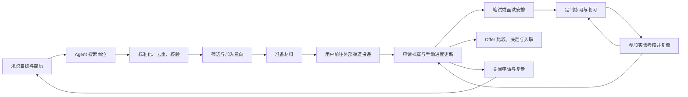

# OfferPilot 完整业务方案 v2

> 日期：2026-10-23｜阶段：业务设计，尚未实施。
>
> 本版根据新增需求重新定义产品：主动搜索岗位、管理求职申请、围绕真实目标定制面试训练。本文替代 v1 的业务范围与功能优先级；v1 中的来源追溯、事实确认、版本历史等原则继续保留。本文不包含开发提示词、数据库设计或代码任务。
>
> 文中的流程、默认值、示例和验收标准是产品建议，合成例子不代表已经抓取到真实岗位或取得实际效果。原《02_OfferPilot_具体实施方案.md》保留，便于对照。

## 1. 对三个新想法的判断

| 想法 | 判断 | 应当如何落到业务上 |
|---|---|---|
| Agent 根据关键词搜索网络、筛选、去重、去假、标准化收录 | 合理，应该升级为核心入口 | 用户创建搜索任务，Agent 交付带来源的岗位列表；同时展示搜索范围、筛除理由、重复关系、信息缺口和核验结果 |
| 用工单管理意向、投递、简历池、笔面试、Offer，并手动同步官网进度 | 合理，适合当前接入条件 | 每次申请建立档案，采用“主阶段＋公司原始状态＋多轮考核记录＋下一步任务”；用户查看官网后更新，不假装实时同步 |
| 根据招聘条件、用户简历和网络面经定制习题 | 合理，能形成持续使用价值 | 从“生成一份题单”扩展到“岗位能力地图→练习→反馈→复习→真实面试复盘”，并区分历史分享与系统生成题 |

三个想法的价值来自相互连接：找到的岗位直接进入申请档案，档案内的 JD、实际投递简历和下一轮面试共同决定练习内容，面试复盘再更新薄弱点与求职策略。

两处需要修正产品承诺：

- “去假”定义为来源核验、招聘有效性检查和风险线索筛查。系统可以指出证据和疑点，不能承诺所有收录岗位都真实可靠。
- “公司简历池”不是每家公司都必经的统一阶段。只有用户在官网或通知中明确看到相关状态，平台才记录；长时间无回复不自动等于入池或淘汰。

## 2. 产品定位、用户与边界

### 2.1 一句话定位

**OfferPilot 是一个面向求职者的 AI 求职工作台：帮用户发现可申请的岗位，跟进每一次申请，并为下一场面试做好有针对性的准备。**

第一阶段仍聚焦软件开发、AI 应用、测试和技术型产品实习，先把岗位字段、匹配规则和练习内容做深。验证后再扩展应届全职和其他职业方向。

### 2.2 三个使用场景

| 用户状态 | 最迫切的问题 | 产品入口 | 期望交付 |
|---|---|---|---|
| 还在找机会 | 去哪里找、哪些能投、信息是否过时 | 找岗位 | 一组带来源、可筛选的候选岗位 |
| 同时推进多家公司 | 投过哪家、用哪版简历、下一步做什么 | 我的申请、今日待办 | 可回查的申请档案和明确待办 |
| 已有具体面试 | 优先复习什么、会如何追问自己的项目 | 面试准备 | 针对岗位、轮次和个人薄弱点的训练包 |

这三个入口可以独立使用。已有面试的用户允许直接补录岗位、简历和面试安排，不必先走完整搜索流程。

### 2.3 产品应承担的承诺

1. 岗位信息有来源，信息缺失和冲突会明确展示。
2. 申请进度能回看，下一步行动不会淹没在聊天记录里。
3. 练习内容能解释为何与该岗位、该用户有关。
4. 用户能够修改 Agent 的结果，所有重要变动有记录。

首版不承诺覆盖所有招聘网站，不自动代投，不登录用户招聘账号，不预测录用概率，不出售候选人资料。保留手工导入作为补充，但真实联网搜索属于首版核心功能，不能用手工输入或演示数据替代验收。

## 3. 完整业务闭环

平台内需要区分三个对象：

- **岗位**：外部招聘机会，可能有多个来源、多个 时间版本。
- **申请**：某个用户针对一次招聘机会的推进记录，包含实际使用的材料和历史进度。
- **任务**：为了推进某次申请或训练需要完成的一件事，例如核验地点、提交作品集、复习一道题。

一个岗位可以被收藏而未申请；一次申请可以有多轮面试；一次面试可以关联多个任务。搜索到岗位不自动创建投递记录，完成练习也不自动改变申请阶段。

## 4. 全部功能模块

| 模块 | 主要功能 | 用户得到什么 |
|---|---|---|
| 求职目标与个人资料 | 求职方向、硬条件、偏好、简历与事实确认 | 可复用的搜索与准备依据 |
| Agent 找岗 | 关键词搜索、条件解释、多来源发现、搜索报告、再次搜索 | 持续扩充的候选岗位 |
| 岗位情报库 | 统一字段、去重、版本更新、来源核验、风险提示 | 容易浏览与比较的岗位卡片 |
| 岗位筛选与意向 | 三态条件判断、匹配解释、收藏、排除、比较 | 值得进一步行动的候选清单 |
| 申请档案 | 外部链接、实际投递材料、主阶段、多轮流程、事件历史 | 每次求职申请的一本完整台账 |
| 材料准备 | 简历版本、项目证据、岗位差距、联系草稿 | 与该次申请一致的材料包 |
| 面试准备与练习 | 面经检索、能力地图、定制题单、文本练习、反馈、复习 | 可持续迭代的岗位训练包 |
| 待办与日程 | 查询进度、材料截止、笔面安排、复习任务、提醒 | 今日应做事项与临近期限 |
| 复盘与 Offer 决策 | 面试复盘、薄弱点归档、Offer 比较、接受/拒绝记录 | 下一步更清楚的求职决策 |
| 平台基础运营 | 来源管理、纠错、风险处理、数据控制、使用反馈 | 可维护、可纠错的服务 |

## 5. 求职目标与个人资料

### 5.1 用户可以填写什么

- 目标岗位方向、关键词、城市、远程或现场偏好。
- 毕业年份、学历、最早到岗日期、每周可到岗天数、可持续实习时长。
- 期望薪资及单位、公司或行业偏好、排除条件。
- 简历版本、项目经历、技能、作品链接及用户确认的事实。
- 每日或每周可用于求职与复习的时间。

允许字段为空，不以填完长表单作为使用前提。只想搜岗位时提供关键词和城市即可；需要个性化面试训练时再补充简历与面试时间。

### 5.2 硬条件与偏好必须分开

例如“每周只能到岗三天”属于硬条件；“优先杭州，也能考虑上海”属于偏好。模型识别自然语言后应展示条件摘要，用户可以直接修改。

用户未填写薪资要求，不能默认为低薪可接受；未写远程意愿，不能自动筛掉现场岗位。搜索可以进行近义词扩展，但不能默默改变用户的硬条件。

### 5.3 资料默认私有

简历、联系方式、申请进度、面试复盘和回答记录只属于该用户。对外搜索采用岗位、技能、城市等必要关键词，不把整份简历、姓名或联系方式放进搜索引擎查询。

## 6. Agent 找岗：从关键词到可查看的岗位

### 6.1 搜索任务输入

支持两种方式：自然语言描述，以及关键词加筛选项。

示例：“找杭州或上海的 AI 应用开发实习，Python、Agent 方向，每周能去三天，希望最近发布，排除纯销售岗位。”

用户可选择：

- 严格按条件搜索，或同时查看相近岗位。
- 偏好的公司、来源范围和发布时间范围。
- 本次希望查看的候选数量、搜索深度或耗时上限。
- 是否包含信息不全但可能相关的线索。

其中“最近发布”只使用有依据的发布日期。网页更新时间、搜索引擎抓取时间和平台发现时间分别展示，不相互替代。

### 6.2 Agent 的业务流程

1. 理解关键词与约束，展示可编辑的搜索条件。
2. 扩展岗位别名和技术词，形成多个查询组合。
3. 搜索招聘官网、可用的公开职位接口、允许访问的招聘页面等来源。
4. 尽量读取职位详情，识别岗位而非新闻、课程广告或招聘汇总目录。
5. 提取统一字段，保存来源与采集时间。
6. 去重并关联多来源信息，识别已有岗位的新版本。
7. 检查岗位有效性与风险线索，区分已核实内容和待核实内容。
8. 按用户硬条件与偏好分组，生成可解释的结果列表。
9. 返回搜索报告，允许用户补充关键词、继续搜索或重新搜索。

搜索过程中允许先展示已处理的结果。用户可取消任务；部分来源失败不应使已获得的岗位消失。

### 6.3 来源策略

| 来源类型 | 产品中的用途 | 结果如何呈现 |
|---|---|---|
| 已确认的企业官网、官方招聘域名 | 优先核验职位和投递渠道 | 展示官方页面、核验时间、职位编号（如有） |
| 有使用依据的公开职位接口 | 稳定读取岗位结构 | 保留接口来源、字段与更新记录 |
| 高校就业网、公共就业网站 | 发现岗位并回溯企业来源 | 显示转载或发布主体，不自动等同企业直发 |
| 第三方招聘平台公开页面 | 在允许的访问和使用范围内检索 | 保留原站链接与信息完整度 |
| 社区帖子、公众号等线索 | 扩大机会发现范围 | 标为线索，优先寻找原始招聘信息 |
| 用户粘贴、CSV 或手工补录 | 补充无法自动读取的内容 | 标为用户提供，保留原始来源 |

搜索结果摘要可以作为“待补充线索”，但不能仅凭摘要编造完整 JD。无法读取正文时明确显示“详情未读取”，允许用户跳转原站或补充文本。

某些 ATS 确实提供公开职位数据，例如 Greenhouse 文档说明其 Job Board 的 GET 端点不要求身份认证。这只能说明存在可用的技术路径，不代表国内招聘站均提供接口，也不自动授予所有内容的再发布权。[Greenhouse 官方文档](https://docs.greenhouse.io/job-board)

### 6.4 搜索报告与反馈

一次搜索展示：实际使用的条件、覆盖的来源、发现的链接数、成功识别的岗位数、新增与更新数、重复数、明确不符数、待核实数和失败原因。不同统计维度允许交叉时要注明口径，不能凑出一个看似精确的覆盖率。

每张卡片支持“感兴趣”“不相关”“条件不符”“信息错误”“疑似重复”“风险举报”。反馈用于该用户的后续搜索，不直接修改所有用户的公共信息。

无结果时解释可能原因并建议放宽选项，只有用户接受后才改变约束。不为补足目标数量而编造岗位。

### 6.5 再次搜索与订阅

首版支持保存条件和手动再次搜索。后续增加订阅：用户主动设定频率后，系统只突出新增岗位、关键条件变化或已收藏岗位关闭，避免重复推送旧结果。失败显示失败，不将未执行的搜索展示为“今日无新岗位”。

本节是应用未来的功能设计，不代表本次已经创建任何定时任务。

## 7. 岗位标准化、去重与持续更新

### 7.1 统一岗位卡片

| 字段组 | 建议展示内容 | 处理原则 |
|---|---|---|
| 岗位身份 | 标题、公司、部门、招聘编号、批次 | 原始名称和规范名称可对照 |
| 工作条件 | 城市、办公方式、招聘类型、每周天数、持续时长 | “必须”“优先”“可协商”分开 |
| 候选条件 | 学历、毕业年份、技能、职责、经验要求 | 保留证据和未说明项 |
| 薪资待遇 | 数额范围、币种、日/月/年单位、明确福利 | 不把日薪直接换算为确定月薪；“面议”保留 |
| 时间信息 | 发布、发现、截止、更新、最后核验时间 | 缺失不猜，含糊时间保留原表达 |
| 来源信息 | 官方页、原始页、其他来源、来源类型 | 关键字段能回到来源依据 |
| 核验信息 | 来源状态、开放情况、风险线索、冲突项 | 不压成单一“真实度分数” |
| 个人操作 | 意向等级、申请情况、备注、排除理由 | 仅影响自己的工作台 |

列表优先呈现用户最常用于筛选的信息，长 JD 放在详情。允许对比最多数个意向岗位，重点并排看硬条件、职责、证据缺口和下一步动作。

### 7.2 去重规则

- 同一来源、同一可靠职位编号：关联到同一岗位，内容变化保留新版本。
- 同一原始链接的重复搜索结果：不重复入库，记录再次发现时间。
- 公司、部门、城市、批次和内容高度相近：建立“疑似同岗”关系，证据充分时归并来源，有冲突时待确认。
- 同标题但城市、部门、招聘批次不同：保留为不同岗位。
- 一个页面列出多个城市或多个职位：保留其实际招聘结构，不能机械拆成多个确定职位。

合并保留原来源、旧版本和已有申请引用，可撤销。用户的两次真实申请不能因为岗位去重而被合并掉。

### 7.3 岗位更新

重新读取后，关键变化以差异显示，例如三天变五天、工作地点变化、截止时间延长。用户收藏或已有申请的岗位优先提示变化。

新 JD 不覆盖投递时的旧 JD。旧材料和旧练习保留，新增内容标注“岗位要求有变化，建议重新检查”。

## 8. “去假”的完整产品定义

### 8.1 分成三个独立维度

| 维度 | 回答的问题 | 可展示状态 |
|---|---|---|
| 来源可信情况 | 这条信息从哪里来，主体关系是否核实 | 已核实官方来源、第三方转载、用户提供、来源未核实、来源冲突 |
| 招聘有效情况 | 目前有什么证据表明仍在招聘 | 页面显示开放、明确关闭、已过明确截止日、当前无法判断 |
| 风险线索 | 是否发现值得进一步确认的异常 | 未检出已知风险线索、存在待核实项、发现高风险线索、已确认误报/失效信息 |

“未检出风险”不等于“安全担保”；“官方页面存在”不等于“一定还有名额”；“无法访问”不等于“岗位关闭”。

### 8.2 核验动作

1. 找到公司正式网站与招聘入口，核对发布域名或外部 ATS 的官方关联。
2. 比对职位编号、部门、城市、职责和招聘时间，排查冒用或拼接信息。
3. 检查原始页面是否明确关闭、截止或跳转到别的岗位。
4. 识别招聘内容中的预付款、押金、培训贷、承诺保录用、异常索要资料等风险线索。
5. 记录每项判断的依据、来源、时间和未解决问题。

仅凭薪资偏高、使用外部 ATS、招聘联系人使用个人邮箱或网上信息少，不直接判定虚假。多个转载页面也不算多份独立佐证。

### 8.3 展示和处置

- 一般信息缺口：进入待核实分组，保留浏览和补充入口。
- 多来源矛盾：并排展示冲突值，提供核验任务。
- 有明显风险线索：默认移出推荐主列表，保留风险详情和用户复核入口。
- 明确失效或经核实虚假的内容：停止推荐、记录理由；已有申请保留历史并提示。
- 用户举报：建立纠错记录，由运营复核；不能因一次举报自动给公司贴永久标签。

这里需要的内部工单是“信息核验/纠错工单”，包括对象、问题、证据、处理结果和处理人。它与用户的求职申请档案分开。

## 9. 岗位筛选、匹配与意向管理

### 9.1 先回答能否满足已知条件

每个条件返回：明确满足、明确不满足、待核实。例如用户只能每周三天，而 JD 明确要求至少四天，必须展示冲突；JD 只写“长期实习”，不能猜成六个月。

未明确的条件保留待核实。“符合已知条件”只覆盖已核对范围，不代表满足所有未知要求。模型或人工尚未确认的模糊抽取不能伪装成确定结论。

### 9.2 再回答值得优先准备什么

按以下维度说明推荐理由：与目标方向的相关性、硬条件、个人偏好、已确认项目证据、材料缺口、截止时间和招聘状态。

首版以分组和理由为主，避免复杂评分喧宾夺主。后续如加入分数，应明确是排序参考，不能表现为录用概率。

### 9.3 意向清单

用户可以设置重点推进、一般关注、暂缓或不考虑；保存原因，供后续搜索参考。加入意向时可以创建申请档案，也可暂时只收藏。

重复点击“加入申请”优先打开已有的活跃申请；如果确实是新批次或再次申请，允许明确创建新记录并关联历史。

## 10. 申请工单：一次申请一份档案

### 10.1 工单里保存什么

| 内容 | 具体信息 |
|---|---|
| 申请对象 | 公司、岗位、部门、城市、招聘批次；允许目标岗位暂未明确 |
| 个人意向 | 优先级、选择理由、顾虑、是否仍想推进 |
| 外部入口 | 岗位详情链接、实际投递链接、进度查询链接；三者可不同 |
| 申请识别 | 外部申请编号、渠道、投递时间、再次申请的关联记录 |
| 投递材料 | 实际提交的简历版本、作品集或其他材料版本 |
| 当前进度 | 平台主阶段、公司显示的原始状态、状态来源、最后查看时间 |
| 考核记录 | 笔试、作业、技术面、业务面、HR 面等多轮安排和结果 |
| 关联事项 | 查询进度、补材料、练习、参加面试、回复 Offer 等待办 |
| 历史记录 | 每次更新、补录、更正、备注和结果，不覆盖过去 |

外部链接不保存账号密码和登录凭据。进度页无法深链时可以记录招聘网站首页及“个人中心→我的申请”等导航说明。通过邮箱、内推或线下申请时允许无官网进度链接，不强制伪造入口。

### 10.2 主阶段＋子状态＋具体轮次

主阶段负责看板总览，公司原始状态保留实际表述，笔试和面试轮次负责细节。

| 主阶段 | 可选子状态举例 | 进入依据 |
|---|---|---|
| 意向 | 待比较、重点关注、暂缓 | 用户主动加入 |
| 准备投递 | 修改简历、整理作品集、等待确认条件 | 用户决定准备 |
| 已投递/简历处理 | 已提交、公司显示筛选中、公司明确显示人才池、等待反馈 | 用户确认实际投递；具体公司状态由用户提供 |
| 考核中 | 待笔试、作业准备、面试排期、技术面、HR 面、等待结果 | 用户记录考核通知或已发生的环节 |
| Offer 沟通 | 口头意向、书面 Offer 待确认、条件沟通、待决定 | 用户录入实际通知；口头意向单独标明 |
| 已接受/待入职 | 已接受、材料准备、等待入职日期、已入职 | 用户记录对应实际情况 |
| 已结束 | 拒绝、主动撤回、拒绝 Offer、公司取消招聘、用户停止跟进 | 用户明确选择结束原因或记录结果 |

“已归档”作为显示状态独立于结果；“需查询进度”“长时间未更新”作为待办或提示独立于主阶段。没有消息不自动标拒绝，接受 Offer 不自动关闭其他申请。

同一家公司可能允许多个志愿、调剂或换岗。首版允许用户记录目标变化并关联新岗位，保留原始投递对象；不把不同岗位的历史悄悄拼成一条。

### 10.3 多轮笔试与面试

每个考核环节单独记录：

- 名称和类型，例如在线测评、编程笔试、作业、技术一面、交叉面、HR 面。
- 预计时间、实际时间、时区、截止时间、地点或会议链接。
- 待安排、已安排、已完成待结果、通过、未通过、取消、跳过等状态。
- 对应准备包、题单、材料、用户复盘和下一步。
- 改期、追加、取消或结果更正的历史。

轮次可增删、跳过、追加和调整顺序。例如直接技术面、先 HR 沟通再笔试、三轮技术面后追加交叉面都能记录。完成一面不意味着通过一面，通过二面也不自动等于收到 Offer。

### 10.4 用户手动更新进度的最短路径

1. 申请卡片点击“查看官网进度”，打开保存的外部链接。
2. 用户在原站登录和查看；平台不读取登录态。
3. 返回后点击“更新进度”，选择“无变化”“记录新阶段”或“补录一个环节”。
4. 可以粘贴官网状态或通知原文，Agent 提议平台阶段，由用户确认。
5. 记录状态实际发生时间、平台录入时间、最后查询时间和来源。
6. 根据更新结果建议下一步事项，例如准备一面或设置下一次查询提醒。

点击外链本身不代表已查看；只有用户确认查看结果，才更新最后查询时间。首版文本输入即可，截图识别、邮箱或日历连接以后再考虑。

官网进度查询属于真实存在的用户动作。例如华为招聘 FAQ 提供在个人中心查看申请进展的说明；各公司入口与更新方式不同，不能据此承诺统一接口或统一时效。[华为招聘 FAQ](https://career.huawei.com/reccampportal/portal5/faq.html)

### 10.5 自动生成什么，哪些必须用户确认

- 系统可以根据截止时间展示提醒，根据记录的面试自动整理关联准备事项。
- Agent 可以提出状态映射、跟进建议、联系草稿。
- 是否已投递、是否通过、是否接受 Offer 等实际结果由用户确认。
- 复制草稿、打开官网或下载简历均不触发“已投递”。
- 用户明确设置了提醒规则后，可以自动生成相应待办；自动发邮件或联系招聘方不在首版范围。

## 11. 简历与申请材料中心

### 11.1 基础资料

保存用户的简历版本、项目条目、技能、作品链接和确认过的经历。区分“实际做过”“接触或自学过”“计划做”“内容待确认”。

首版支持简历文本与手动编辑。文本 PDF 的便利性较高，可作为后续优先增强；复杂模板排版和扫描件识别不阻塞核心流程。

### 11.2 岗位材料包

每个申请可以准备：

- 岗位与简历的差距清单。
- 项目展示顺序和自我介绍提纲。
- 对应版本的简历、作品集链接与补充说明。
- 自荐、内推联系或跟进进度的草稿，由用户自行发送。
- 尚需向招聘方确认的问题。

修改表达可以更清楚，但不能把参与写成主导，把计划写成完成，或凭空增加业务规模和效果数字。

### 11.3 投递后锁定历史

记录实际投递时使用的材料。如果没有保存对应版本，标记“投递材料待补录”，不假定当前最新版就是当时版本。

面试准备默认基于实际投递版本；用户可额外加入后来完成的经历，但展示为补充资料。后续修改简历不改变旧投递记录，练习时写出的优秀回答也不自动进入简历事实库。

## 12. 定制面试习题与训练

### 12.1 四类输入共同决定训练内容

| 输入 | 解决的问题 |
|---|---|
| 目标 JD 与岗位条件 | 这份工作需要什么能力 |
| 实际投递简历与已确认项目 | 面试官可能如何围绕用户写过的经历追问 |
| 可用的相关面经与可靠知识资料 | 同类岗位有哪些历史考查线索、知识点如何校核 |
| 面试轮次、剩余时间、历史练习与复盘 | 现在应该优先练什么、难度和任务量多大 |

用户没有完整简历时，可以先生成岗位通用题，再提示哪些项目追问题需要补充个人信息。没有找到相关面经时，使用 JD 和知识资料生成练习，不能虚构“该公司往年考过”。

### 12.2 面经搜索与整理

用户选择“搜集相关面经”后，Agent 按公司、岗位方向、部门（如已知）、实习/校招/社招、面试轮次、发生时间和技术栈搜索。

每条面经记录：原链接、发布平台、发布时间、面试发生时间（如作者提供）、对应公司/岗位/轮次、提到的主题、适用范围和信息缺失。转载或高度重复内容归为同一线索，避免同一篇被转载五次就认为出现五次。

相关性优先级建议为：同公司同方向同招聘类型，其次同方向同招聘类型，最后一般技术知识参考。不同部门、不同年份或社招经验不能无说明套到实习岗位。

面经属于个人分享，保留“作者自述、未经独立核实”的性质。优先保存必要摘要、主题与原链接，并依据来源使用规则处理内容；不建设整篇复制的面经镜像库。受限页面可以让用户补充有权使用的文本。

### 12.3 区分三种题目来源

1. **历史分享提及**：有具体可回查的面经来源；可做必要概括，注明转述和适用时间。
2. **基于目标岗位生成**：由 JD、简历或薄弱点生成的模拟题。
3. **通用知识练习**：与岗位能力相关的通用题，不声称某家公司考过。

同一主题在样本中的出现次数可以展示，但要带样本数与范围。不把它解释成未来面试出题概率，也不将生成题包装成“内部真题”。

### 12.4 先构建岗位能力地图，再出题

例如 AI 应用开发实习可以包含 Python/API、数据处理、检索增强、工具调用、异常处理、产品交互、评测等主题，具体以该岗位证据为准。

能力地图分为：岗位明确要求、简历主动声明、面经参考主题、已有薄弱点。每个主题显示为什么需要准备、已有证据、待补材料和练习优先级。

项目追问优先围绕：做过什么、具体负责哪部分、为什么这样设计、如何验证、遇到什么失败、规模或效果依据是什么。用户只有原型就问原型，不替用户构造真实企业生产经验。

### 12.5 可生成的训练内容

| 训练类型 | 内容举例 | 输出形式 |
|---|---|---|
| 自我介绍 | 用现有经历说明与岗位的关联 | 提纲、时间版本、事实依据 |
| 项目深挖 | 方案选择、个人贡献、失败处理、指标依据 | 主问题＋逐层追问 |
| 技术基础 | 语言、数据库、网络、框架、工程实践 | 概念题、场景题、边界题 |
| 岗位专项 | Agent 工具调用、RAG、测试设计、产品分析等 | 按 JD 定制的案例题 |
| 编程与笔试 | 数据结构、调试、SQL、接口或算法小题 | 题面、输入输出、解题要点；在线执行后续增强 |
| 行为与协作 | 团队分工、困难处理、沟通、学习过程 | 真实经历梳理与追问 |
| HR 与到岗沟通 | 到岗安排、求职动机、实习计划 | 问题清单和用户可编辑提纲 |
| 反问面试官 | 团队职责、技术栈、带教、工作安排 | 与信息缺口对应的反问清单 |

### 12.6 每道题需要哪些信息

- 题目、类型、知识主题、建议难度。
- 为什么推荐给该用户，关联哪个 JD 要求、简历项目或面经线索。
- 来源类别与可打开的参考链接。
- 考查点、回答评价要点、可选提示、常见误区和追问。
- 用户回答、练习记录、反馈、掌握情况及下一次复习安排。

参考答案在用户作答后展开，允许先看提示。客观知识点优先用可靠资料校核；存在争议或依赖环境的答案说明前提。个人经历题提供组织框架，缺失细节留给用户补充，不生成虚构的一人称经历。

### 12.7 示例：一条有依据的定制练习

以下完全为合成示例，不代表任何公司的真实面试题。

目标岗位要求 API 开发、异常处理和基础 Agent 应用；用户确认的经历是“使用 Vue3 实现任务列表与状态筛选”。

- 题目：“任务创建后页面需要显示进度，你会如何设计状态更新和错误提示？”
- 推荐理由：连接岗位的接口与异常处理要求，以及用户确实做过的任务页面。
- 第一层追问：“如果请求超时，但服务端任务实际上已经创建，界面如何处理？”
- 第二层追问：“如果刷新页面后还要继续显示任务进度，需要保留哪些信息？”
- 事实边界：“你做过的部分是什么？其余部分如果只是设计设想，请明确区分。”
- 评价要点：状态是否清楚、是否识别重复提交、是否解释恢复路径、是否如实描述个人贡献。

这类题比无差别生成大量 Agent 概念题更贴近用户的实际准备任务，但其有效性仍需通过使用反馈验证。

### 12.8 练习、反馈与复习闭环

1. 用户选择准备目标、面试日期与可用时间。
2. 系统给出可编辑的短题单和复习安排，避免一次塞入大量重复题。
3. 用户逐题回答，首版以文字为主。
4. Agent 按正确性、完整性、表达结构、项目证据和岗位相关性给出具体反馈。
5. 用户可纠正评价、标记题目不相关或设置掌握程度。
6. 错题和薄弱主题进入复习队列，后续通过相似题或追问再次检查。
7. 真实面试结束后补录问题与表现，更新下一轮准备内容。

训练反馈不是招聘结论，不输出“面试通过概率”。用户看过答案不等于掌握，完成任务不等于已经具备可写入简历的项目经历。

### 12.9 按面试时点组织

- 尚无面试：围绕意向岗位做基础练习。
- 收到一面通知：生成该岗位的项目追问和基础题包。
- 准备后续轮次：吸收上一轮问题与不足，结合用户掌握的轮次要求调整；不知道考查重点时明确按通用准备。
- 临近面试：优先复习已有薄弱点、自我介绍和反问，不自动堆新题。
- 面试结束：保存复盘，生成少量补强任务。

后续可以增加文字模拟面试、语音练习和完整笔试环境。首版先保证题目有依据、反馈可理解、复习有记录。

## 13. 待办、日程与其他必要工单

### 13.1 不把所有事情都做成独立大工单

以申请档案为主，其他事项作为关联任务。搜索运行和练习记录保留各自历史，通过引用关联，不另建一套相互冲突的“求职状态”。

| 事项类型 | 触发例子 | 完成标准 |
|---|---|---|
| 信息核验 | 每周到岗要求缺失、岗位来源矛盾 | 用户确认结论或记录仍未知及下次核验时间 |
| 材料准备 | 作品集缺入口、需要一版岗位简历 | 指定材料已准备并经用户确认 |
| 实际投递 | 用户准备申请某岗位 | 用户确认在外部渠道提交，记录时间与材料 |
| 查询进度 | 到了用户设置的查询日期 | 用户记录已查看和查询结果，可为无变化 |
| 笔试或作业 | 通知要求在某时前提交 | 用户确认完成/提交，结果另行记录 |
| 面试准备 | 已安排某轮面试 | 完成用户选择的准备清单 |
| 面试参与 | 用户录入面试安排 | 记录实际参加、取消或改期 |
| 面后复盘 | 面试已完成 | 记录问题、表现、待补强点 |
| Offer 决策 | 收到有回复期限的通知 | 用户记录决定，实际回复由用户完成 |
| 入职准备 | 已接受 Offer | 用户确认所需事项完成，不集中收集无必要的敏感证件 |

### 13.2 通用任务规则

任务可以处于待办、进行中、等待外部反馈、已完成、已取消；逾期单独标识。每项任务带来源、关联对象、截止时间、下一步与完成标准。

同一场面试的改期更新相关提醒，避免产生多个过期提醒。关闭申请时提示处理未完成任务，可以取消，也可保留为通用学习任务。重复生成准备包时展示新增差异，避免反复创建相同待办。

### 13.3 今日工作台

首页集中展示：

- 今天和临近的笔面试、材料截止、Offer 回复期限。
- 用户设置的进度查询事项。
- 重点岗位的新增信息与要求变化。
- 今天要练的题、需要复习的薄弱点。
- 尚待用户确认的资料和核验结论。

提醒规则由用户设置并可暂停。首版提供站内待办与到期提示；后台定时通知、日历导出或连接在后续阶段加入，并清楚告知是否需要打开应用才能看到。

## 14. 面试复盘与 Offer 决策

### 14.1 一次面试一份复盘

记录实际被问的问题、用户如何回答、认为不清楚的地方、明确收到的反馈、下一轮安排和个人感受。

“面试官明确说了什么”和“我认为可能是什么原因”分开。没有收到结果时不推断已拒绝；没有具体反馈时不让 Agent 编造失败原因。

真实面试问题默认私有。跨用户分享需要单独授权和内容处理，不能把个人复盘自动加入公开题库。

### 14.2 Offer 比较

支持并排比较公司、岗位职责、工作城市、薪资单位、实习时长、到岗要求、带教信息、回复期限、入职时间和个人偏好。

口头意向与书面通知分开。来源没提到的待遇标为待确认，薪资统计口径不同就提示，不擅自推算确定收入或转正概率。

用户可以记录待沟通、接受、拒绝或失效，并创建回复/核实任务。系统提供比较视图和问题清单，最终决定由用户作出。

### 14.3 求职复盘

提供已申请数量、当前阶段分布、待办完成情况、面试邀约记录、练习薄弱点和不同求职方向的个人反馈。

报表明确统计时间、样本量和未出结果的申请。等待反馈不计作拒绝，不能用搜索曝光、收藏或复制草稿数量冒充实际投递。首期用描述性统计帮助用户复盘，不声称证明某种练习提升了录用率。

## 15. 平台运营与用户数据边界

### 15.1 平台岗位资料与个人求职资料分开

具备相应使用依据的公开岗位信息，可以在平台形成可复用的来源目录和标准化条目。用户自己的搜索任务、收藏、简历、申请和训练记录默认私有。

用户粘贴的资料、仅对特定人开放的岗位以及私人备注，不因“收录到平台”就被公开。首版交付个人工作台，不开放企业自行发布岗位或公共候选人展示；公共岗位广场属于后续独立范围。

### 15.2 最小运营能力

| 能力 | 运营人员需要处理什么 |
|---|---|
| 来源目录 | 确认来源用途、可访问范围、可保存内容、更新方式和失效情况 |
| 搜索质量 | 哪些来源常失败、哪些关键词带来无关信息、是否需要停用某个来源 |
| 岗位纠错 | 字段错误、误合并、错误有效性判断、过期信息 |
| 风险复核 | 用户举报、处理依据、恢复误伤岗位、保留处理记录 |
| 训练内容纠错 | 无依据的“真题”、错误参考答案、无关追问、重复题 |
| 使用与成本 | 搜索次数、任务失败、模型使用量、用户配额和取消任务 |
| 反馈处理 | 用户问题、处理状态、解决结果 |

首版不需要庞大的客服和审核系统，但应有内部列表能查看错误并处理反馈。运营权限不意味着可以任意浏览真实简历，查看个人内容应有明确授权与访问记录。

### 15.3 数据控制

用户可以修改、导出和删除个人资料；删除范围包含简历衍生信息、训练回答和相关生成内容，实际保留范围与备份清理周期应如实说明。

告知用户哪些内容会被交给外部模型处理，按任务传递必要信息。未启用网络搜索时，不应偷偷搜索用户身份信息；启用找岗也不意味着授权搜索其社交资料。

若后续转为公开聚合发布或向企业提供招聘信息发布服务，需要按实际业务核对适用的许可、来源授权和发布责任。2026 年有关部门通知已对网络招聘信息发布、来源标注等提出要求；个人工具和公开发布平台不能仅靠产品命名判断适用边界。[有关部门通知](https://www.cac.gov.cn/2026-01/15/c_1770207718756257.htm)

## 16. Agent 在业务中的组织形式

从用户角度可以理解为四类助手，产品内部不必做四个独立聊天窗口，也不要求它们自由互相讨论。

| 能力角色 | 用户触发点 | 主要交付 | 边界 |
|---|---|---|---|
| 岗位发现助手 | 开始搜索、再次搜索 | 候选岗位、搜索报告、标准化结果 | 不自行放宽硬条件、不编造岗位 |
| 信息核验助手 | 收录、刷新、用户举报 | 来源关系、有效性证据、风险线索 | 不提供绝对真实性担保，不无依据封禁 |
| 求职准备助手 | 加入申请、准备材料、更新进度 | 差距清单、材料提纲、待办建议、状态映射建议 | 不代替用户确认实际投递或外部结果 |
| 面试教练 | 创建训练包、回答问题、面后复盘 | 题单、追问、反馈、复习安排 | 不伪造面经来源，不编造本人经历 |

跨模块通过同一份岗位、申请、简历和复盘记录衔接。用户在岗位详情点“准备面试”，不应重新向一个聊天机器人解释全部背景。

业务状态、数据权限和完成确认由产品规则控制。Agent 可以自动执行已选择范围内的搜索、整理和生成，涉及外部投递、发送消息、接受 Offer 等动作仍由用户操作。

## 17. 页面组织

建议主导航保持七个入口，将相关详情放入对应入口，减少页面间跳转。

| 入口 | 页面主要内容 | 常见操作 |
|---|---|---|
| 今日 | 日程、待办、临近截止、重点变化 | 查看进度、开始复习、处理提醒 |
| 找岗位 | 搜索输入、条件摘要、搜索过程、结果报告 | 新建搜索、改条件、再次搜索 |
| 岗位库 | 已收录岗位、筛选、意向、排除、比较 | 看来源、核验、加入申请 |
| 我的申请 | 看板、列表、申请详情、多轮考核、时间线 | 打开官网、更新进度、加面试、记录 Offer |
| 面试准备 | 岗位训练包、面经线索、练习、薄弱点、复盘 | 做题、看反馈、复习、模拟面试 |
| 我的资料 | 求职目标、简历版本、事实和作品 | 确认事实、调整偏好、更新材料 |
| 复盘 | 求职统计、训练变化、Offer 比较 | 调整方向、比较选择、归档 |

搜索结果中完成基础收藏即可；申请详情内直接看到“材料、考核、练习、待办、历史”。用户不需要先理解“Agent Run”等实现概念才能操作。

## 18. 典型使用案例

以下为合成业务演示，不是实测数据。

用户是寻找 AI 应用实习的学生，每周可到岗三天，倾向杭州或上海，已确认自己做过 Vue3 页面和 API 集成。

1. 用户输入关键词和约束，Agent 搜索并返回岗位。
2. 某岗位明确要求四天，进入“条件不符”；另一条没写天数，进入“待核实”，并生成核验建议。
3. 同一公司同一岗位出现在两个来源，合为一个岗位的两个来源；不同城市的相似职位保留两条。
4. 用户选择重点岗位，建立申请档案，记录招聘官网和查询进度入口。
5. 用户准备一版针对性简历，自己在官网提交，再返回记录“已投递”和使用的材料。
6. 几天后用户手动查看官网，状态无变化，记录查询时间并设置下一次查看日期。
7. 收到一面通知后，用户新增“技术一面”和时间，系统给出准备清单与岗位训练包。
8. Agent 结合 JD、投递版简历和找到的相关面经线索出题；没有对应面经的题标为系统生成。
9. 用户回答后发现异常处理讲不清楚，加入复习；实际一面结束后补录问题，继续准备二面。
10. 用户收到书面 Offer，记录回复期限、待遇和地点，与其他机会比较，完成个人决定。

该案例贯穿三个核心模块，也覆盖了“不满足条件”“信息未知”“来源重复”“官网无变化”等日常情况。

## 19. 分阶段业务范围

### 阶段 0：验证来源与流程可行性

在选定职业方向上验证少量有使用依据的来源，跑通一次实际网络搜索、详情读取和字段整理；同时用几份用户授权或合成资料走查申请和练习流程。

交付来源覆盖说明、典型好坏样本、无法读取的情况、统一岗位卡片和用户走查记录。不能用国外 ATS 的可用性推断国内目标岗位足够覆盖；国内目标来源需单独验证。

### 阶段 1：找岗位与跟进申请

必做：

- 关键词/自然语言联网搜索，可查看真实来源和搜索结果。
- 标准化岗位、基础去重、硬条件筛选、来源/有效性/风险提示。
- 意向清单、岗位详情、手工补录。
- 简历文本、确认事实与版本记录。
- 申请看板、外链、手动更新、可增减的考核轮次、时间线。
- 基础材料待办、站内到期提示、岗位纠错、个人数据控制。

阶段目标：用户能够找到岗位，自己完成真实投递，并用平台清楚记录下一步。这是可试用的第一段业务链路，不称为完整 v2。

### 阶段 2：完成岗位定制训练闭环

必做：

- 以申请中的 JD 和实际投递简历为基准建立准备包。
- 检索可用面经，标注来源、相关性、时间与不确定性。
- 定制短题单、项目追问、文字回答、具体反馈和薄弱点。
- 复习任务、面试复盘、下一轮准备。
- 基础 Offer 记录、回复期限和比较。

**阶段 1＋阶段 2 共同构成新版 P0。** 这使用户提出的三个主模块都进入首个完整版本，而不是把联网找岗或定制练习无限后置。

### 阶段 3：增强持续使用体验（P1）

- 搜索订阅、岗位关键变更提醒、更多可用来源。
- 面经更细的去重与适用性筛选、完整文字模拟面试。
- 跨岗位薄弱点归纳、可调整的复习计划。
- 文本 PDF、日历导出/连接、用户授权的通知内容导入。
- 完善运营纠错、质量评估、成本与使用报告。

### 后续探索（P2）

语音模拟面试、编程执行环境、用户授权的邮箱/招聘系统连接、跨用户内容分享、公共岗位广场。每项单独验证价值与接入条件，再决定是否做。

持续不纳入当前范围：自动海投、自动群发联系、绕过网站访问限制、付费保 Offer、无依据的真假或录用概率判断。

## 20. 首个完整版本的业务验收

| 场景 | 应看到的结果 |
|---|---|
| 只输入方向与城市搜岗位 | 有实际联网结果、可打开来源和统一字段，不强制先上传简历 |
| 网络搜索无结果或部分失败 | 保留已获取结果，解释覆盖和失败，不编造补足数量 |
| 正文不可读、只获得摘要 | 标记为待补充线索，不生成完整确定 JD |
| 同岗多来源、异岗同标题 | 前者关联来源，后者在城市/部门/批次冲突时保持独立 |
| 岗位缺失到岗要求 | 显示待核实，不猜测通过或不通过 |
| 原站失效、明确截止与临时访问失败 | 分别展示对应依据，不混为一个“假岗位” |
| 用户发现核验误判 | 能纠错、复核，恢复误伤信息，并保留记录 |
| 用户实际外网投递后补录 | 申请档案包含实际日期、渠道和当时材料；打开链接不自动算投递 |
| 公司无简历池、跳过笔试、追加第三轮 | 能按实际情况记录，不强制固定路径 |
| 用户查看官网但状态不变 | 更新最后查看时间，原阶段保持不变 |
| 修改简历或 JD | 历史投递保持原版本，准备包显示资料变化 |
| 生成定制题单 | 能解释题目与该 JD/简历的关系，区分面经转述与系统生成 |
| 查不到面经 | 可以继续按 JD 和简历练习，明确无对应历史来源 |
| 用户经历里包含计划中项目 | 不生成已完成的自述，不把建议经历加入简历 |
| 完成练习与真实面试复盘 | 薄弱点和下轮准备更新，申请结果仍由用户确认 |
| 收到 Offer | 可记录口头/书面性质、回复期限、比较和决定 |

此外，跨用户资料不可访问，导出/删除路径可用。验收使用真实联网样本时记录来源和时间；合成边界样本单独标记。

## 21. 如何验证业务是否有价值

先观察用户能否完成三个具体任务：找到值得进一步查看的岗位、回顾多家公司的申请进展、为一场已知面试完成有针对性的练习。

| 观察方向 | 建议记录 | 不能据此声称什么 |
|---|---|---|
| 找岗效率 | 整理一组可用意向岗位的总时间、无关结果、重复/过期/错误比例 | 搜索到很多链接不等于找岗有效 |
| 核验质量 | 人工复核支持的结论、误伤、未知是否保留、纠错耗时 | 未检出风险不等于全部真实 |
| 申请管理 | 用户能否找到对应材料和下步事项、漏记漏跟进情况 | 更新看板不等于公司真的推进 |
| 准备质量 | 题目相关性、事实和来源错误、练习后能否解释关键问题 | 练习分数不等于通过率 |
| 持续使用 | 用户是否再次搜索、更新申请、回来复习和复盘 | 打开页面数不等于真实价值 |

首轮可以邀请 5–8 位目标用户完成固定任务，结合耗时、错误和访谈进行调整。这是拟议验证方法；没有实际招募前不能写“已验证需求”。

不急于上线付费。以后若验证出持续价值，可以评估深度搜索和训练额度等服务，但不销售候选人隐私，也不将付费与“岗位保证真实”“保录用”绑定。

## 22. 相对 v1 的关键变更

| 旧方案重心 | 新版调整 |
|---|---|
| 用户先收集 JD，产品主要整理 | Agent 主动联网搜索成为核心，手工导入保留为补充 |
| 去重、核验主要属于增强项 | 基础去重、有效性和风险线索进入岗位发现链路 |
| 一份准备计划与自荐草稿 | 扩展为岗位训练包、定制练习、反馈、复习和真实面试复盘 |
| 基础投递阶段看板 | 升级为申请档案、多轮考核、外部查询入口和手动进度更新 |
| 重心偏向执行框架与技术展示 | 当前优先验证用户业务闭环，技术架构和工程提示词后续再设计 |
| 目标是可信材料与可追溯记录 | 保留并扩展到来源可追溯、状态有依据、练习内容可解释 |

当前最值得完成的产品链路是：**真实联网找到机会 → 用户确认选择并投递 → 平台记录下一步 → 针对下一轮面试训练 → 复盘和继续推进。**

