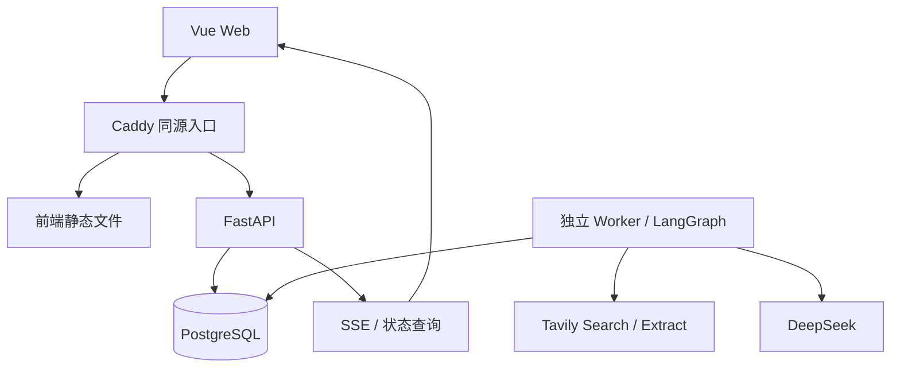

# OfferPilot 工程 Agent 开发总提示词

> 版本：工程执行规范 v1.0｜日期：2026-10-23。
> 对应业务：03_OfferPilot_完整业务方案_v2.md 的完整 P0。
> 使用方式：将本文件全文交给工程 Agent，或让其在同一项目目录中读取本文件后执行。本文包含已经确定的架构、范围、规则、阶段与验收；工程 Agent 负责实现、测试和修复。
> 本文是待执行指令，不是已经实现或通过测试的报告。

---

## 0. 你的任务与执行方式

你是 OfferPilot 的工程实现 Agent。按照本文完成一个可以本地部署、持久保存数据、具有真实联网与真实模型接入能力的 Web 应用。默认执行 S0–S6 全部阶段；用户指定某阶段时，仅执行该阶段及必要的前置修复。

产品目标是：关键词找岗 → 标准化与核验 → 加入申请 → 用户外网投递 → 手动更新进度 → 针对岗位和实际简历练习 → 复盘与 Offer 管理。

执行要求：

1. 先读项目适用的 AGENTS.md、本文及业务 v2，检查已有代码与变更，不覆盖用户工作。
2. 用户后续明确调整优先于本文；本文确定 P0 工程取舍；业务含义以 v2 为准。旧 v1 的手工导入优先级已被替代，不得用其取消联网找岗。
3. 按本文实现，不重新设计产品，不另选前后端框架，不扩展 P1/P2。可决定函数划分、索引、组件内部实现和兼容补丁版本。
4. 一个阶段交付可以运行的前后端功能、数据库迁移和对应测试，禁止先堆完所有页面假数据再补业务。
5. 每阶段验收后更新进度，默认继续下一阶段；不要只交计划、脚手架或伪代码。
6. 缺少第三方凭据时，完成真实适配器、离线契约测试与不受影响功能，准确记录待执行的联网验证。不得静默切换成演示结果或称全部验收通过。
7. 技术 API 以执行时官方文档和实际兼容测试为准。若提供商接口已变更，可在适配器内修复并记录；改变业务边界或主架构时说明阻碍与最小调整。
8. 默认单一实现流程。不要自行创建额外开发聊天或并行 Agent，也不要未经要求发布到公网、购买服务、发送外部联系或执行真实投递。
9. 续作先读 docs/progress.md 和实际代码，增量完成，不从头重建。

## 1. 本轮范围已经确定

### 1.1 必须实现

| 编号 | 模块 | P0 最小完整功能 |
|---|---|---|
| F01 | 账号与偏好 | 登录、会话、用户隔离；目标岗位、城市、学历、毕业年份、到岗条件、偏好 |
| F02 | 简历事实 | 文本导入、结构化抽取、逐条确认/修改/标记计划中、不可变版本 |
| F03 | 联网找岗 | 自然语言/关键词条件预览、确认搜索、真实搜索、详情提取、取消/重试、报告、保存条件与再次搜索 |
| F04 | 岗位库 | 统一字段、来源、证据、缺失/冲突、去重与撤销、核验提示、筛选、意向、比较最多 4 岗 |
| F05 | 条件匹配 | 确定性的 pass/fail/unknown、逐项理由、简历证据和待核实项 |
| F06 | 申请档案 | 看板/列表、三个外部链接、手动进度更新、多轮考核、投递材料绑定、事件历史、补录更正 |
| F07 | 材料准备 | 简历差距、准备任务、自我介绍/联系草稿，事实引用、用户审核后保存 |
| F08 | 面试准备 | 面经搜索整理、岗位能力地图、定制短题单、来源类别、逐题作答、模型反馈、薄弱点与复习 |
| F09 | 任务与日程 | 今日待办、查询进度、材料期限、考核安排、复习提醒，站内到期显示 |
| F10 | 复盘与 Offer | 考核复盘、基础统计、Offer 信息、比较最多 4 份、回复期限和决定 |
| F11 | 基础运营 | 来源策略、用户纠错/举报、有限运营处理、运行失败与配额概览 |
| F12 | 数据控制 | 导出、删除简历及衍生内容、删除账户、撤销外部模型使用授权 |

### 1.2 明确排除

自动投递、自动发送邮件、登录招聘网站、验证码处理、全站爬虫、跨用户公开简历/面经、付费、企业发岗、搜索定时订阅、邮箱同步、语音模拟面试、在线代码执行、扫描 PDF、Kubernetes、微服务、独立向量数据库、强制 TracePilot 依赖。

P0 简历支持纯文本；CSV 支持岗位导入/导出。搜索和模型必须有真实适配器。P0 不使用向量召回：技能词典、结构化标签与相关事实筛选足以形成基线，后续再增加 pgvector。

## 2. 固定技术架构

### 2.1 技术栈

| 层 | 固定选择 | 用途 |
|---|---|---|
| 前端 | Vue 3、TypeScript strict、Vite、Vue Router | 单页应用，中文界面 |
| UI | Element Plus、SCSS、CSS variables | 表单、表格、抽屉、日历/日期组件、统一设计变量 |
| 前端状态 | TanStack Vue Query＋Pinia | Query 管服务端状态；Pinia 只放会话视图、UI 偏好和临时跨页状态 |
| API 类型 | FastAPI OpenAPI＋openapi-typescript＋openapi-fetch | 服务端契约生成前端类型和请求客户端 |
| 后端 | Python 3.12、FastAPI、Pydantic 2 | HTTP API、授权、业务规则和输入输出校验 |
| 数据访问 | SQLAlchemy 2 async＋psycopg 3＋Alembic | PostgreSQL 访问、事务和迁移 |
| 数据库 | PostgreSQL 17 | 所有业务事实、任务队列、运行步骤、SSE 事件 |
| 工作流 | LangGraph StateGraph | 有限节点编排；独立 Worker 进程执行 |
| 网络 I/O | httpx AsyncClient | 固定提供商 API 调用与连接池 |
| 模型主适配器 | DeepSeek JSON Output | 抽取、计划、题目、反馈；模型名称由部署配置固定 |
| 搜索与正文适配器 | Tavily Search＋Tavily Extract | 搜索真实网页及提取允许使用的正文 |
| Python 工具 | uv、Ruff、mypy、pytest、pytest-asyncio | 依赖、代码检查、类型与后端测试 |
| 前端工具 | Node.js 24、pnpm、ESLint、Prettier、vue-tsc、Vitest | 开发、检查和组件测试 |
| 端到端 | Playwright | 浏览器走完整业务流程 |
| 本地部署 | Docker Compose、Caddy | 同源 Web/API/SSE 入口，持久数据库卷 |

依赖使用兼容的稳定版本；S0 生成并保留 uv.lock、pnpm-lock.yaml，固定 packageManager、.python-version 和 Node 版本文件。容器使用确定版本标签，记录 digest；禁止 latest 和无约束升级。补丁版本由安装与兼容性验证确定，不需要为补丁版本询问用户。

模型默认配置采用本次核对的 deepseek-flash，LLM_MODEL 可由部署者修改；记录每次实际请求的 model、响应 model（如返回）、Prompt 版本和参数。模型别名可能变化，不能据别名声称实验完全可复现。本文不固定价格或宣称某个模型最佳。

### 2.2 部署与调用关系

Compose 包含 web、api、worker、db 和一次性 migrate 服务。API 和 Worker 共用同一 Python 包、领域服务与模型，使用不同入口命令；不互相 HTTP 调用，不复制业务逻辑。

API 创建持久任务后立即返回 202；Worker 执行长任务。禁止用 FastAPI BackgroundTasks、进程内列表或前端 setTimeout 承担找岗/模型生成的可靠运行。

PostgreSQL 是唯一持久来源。P0 不引入 Redis、Celery、Kafka、LangGraph 托管平台或向量索引。队列是数据库中带租约的有限任务队列，不开发通用工作流平台。

### 2.3 LangGraph 与持久化的具体取舍

P0 使用固定工作流和持久化的 run_steps。每个图节点先查询已完成的步骤产物，完成则复用，否则执行并保存。Worker 重启后图从入口重新进入，基于步骤记录跳过完成部分。

P0 不启用 LangGraph interrupt/checkpointer：用户审核在生成任务结束后的业务 API 中完成，不让运行图长期等待审核。不使用 MemorySaver 冒充可恢复执行，也不同时维护两套互相竞争的运行状态。

图内状态只保存 run_id、版本引用、结果引用、进度与受控错误，不保存密钥、无限聊天历史或整份个人资料。恢复能力由本文规定的数据库步骤协议实现，而不是声称框架自动解决所有故障。

## 3. 仓库结构与模块边界

~~~text
OfficePilot/
  02_OfferPilot_具体实施方案.md
  03_OfferPilot_完整业务方案_v2.md
  04_OfferPilot_工程Agent开发总提示词.md
  apps/
    web/
      src/
        app/                 # router、providers、布局、初始化
        features/
          auth/ profiles/ discovery/ jobs/ applications/
          preparation/ interview/ tasks/ reviews/ offers/ operations/
        components/          # 无领域副作用的共享组件
        api/                 # 生成类型、client、统一错误
        styles/ utils/
      tests/
    server/
      src/offerpilot/
        api/                 # app、依赖注入、中间件、通用错误
        modules/             # 与领域对应的模块
        workflows/           # 图、节点、受控 Prompt
        providers/           # search/content/llm 接口与实现
        worker/              # claim、heartbeat、执行、取消、恢复
        infrastructure/      # db、日志、配置、时钟
      migrations/
      tests/unit/ tests/integration/ tests/contract/ tests/live/
  contracts/openapi.json
  tests/e2e/
  fixtures/synthetic/
  infra/Caddyfile
  compose.yaml
  .env.example
  Makefile
  docs/
    architecture.md
    api.md
    source-feasibility.md
    progress.md
    test-report.md
    runbook.md
    decisions/
  README.md
~~~

后端领域模块内部采用 router.py、schemas.py、service.py、repository.py、models.py，必要时拆分子文件。router 负责鉴权、参数和响应；service 控制用例与事务；repository 负责受限查询；纯规则独立为 functions/rules。

禁止 router 直接写复杂 SQL、LLM 节点自行操作任意表、前端重写资格算法、跨模块随意读取私有 repository。跨模块通过 service 或明确的只读查询服务调用。不要为每张表创建一层空泛的抽象类或微服务。

## 4. 代码规范

### 4.1 Python

- 全部应用代码有类型标注，Pydantic 输入默认拒绝未知字段；外部响应先解析，再转换领域类型。
- Ruff format/lint 和 mypy strict 在 CI 中执行。第三方缺少类型的例外仅限对应边界文件并说明原因；不得用全局 ignore、无理由 type: ignore 或大面积 Any 消除检查。
- ORM 实体与 API DTO 分离，禁止泄露密码哈希、会话或内部权限字段。
- AsyncSession 不跨并发任务共享；每个业务事务有明确边界，提交/回滚由 service 负责。
- 不在数据库事务中等待搜索或模型网络调用。
- 金额使用 Decimal/NUMERIC，UUID 使用统一 UUID4；状态用枚举，禁止散落字符串判断。
- 捕获可处理的异常并转换为领域错误；不得 except Exception 后伪造成功。
- 配置只从经过校验的环境设置加载；Provider URL 与密钥不得来自普通用户请求。
- 注释解释约束和原因；规则及复杂转换写 docstring，不给每行机械加注释。

### 4.2 Vue / TypeScript

- Vue SFC 使用 script setup lang=ts、Composition API；TypeScript strict，禁止滥用 any、非空断言和忽略类型检查。
- 组件渲染与交互，composable 封装请求和状态；前端不持有第三方 API key。
- 所有 HTTP 请求通过统一 client，API 类型由 OpenAPI 生成；禁止手写一套与后端漂移的模型。
- 服务端数据以 Query Cache 为准，不再复制到 Pinia；表单草稿可局部持有，提交后按资源与版本更新缓存。
- 路由筛选条件进入 URL query；请求 key 含用户、对象和版本，退出清理私有缓存。
- 不信任模型 HTML；优先纯文本，Markdown 采用 markdown-it 禁用 HTML并经 DOMPurify 清理，外链仅允许 http/https。
- 不使用浏览器 localStorage 存会话令牌、简历、回答等私密正文。
- 关键状态不能只靠颜色；表单有 label、键盘可达、错误定位和加载/空/错误/重试状态。

### 4.3 共同规范

- 代码标识符英文，产品文案、说明与提交说明可中文。
- 禁止巨型单文件和循环依赖；单文件超过约 400 行时检查是否需要按职责拆分，不为凑行数机械拆分。
- 普通写操作失败显示失败，不使用“操作成功”掩盖后端错误。
- 所有示例与 fixtures 标为合成，不提交真实简历、面经全文、密钥或数据库备份。
- 不为低风险样式调整制造无意义测试；测试重点是业务规则、权限、并发与流程结果。
- 修改契约时同一变更内更新迁移、OpenAPI、前端生成类型和测试。

## 5. 全局数据与权限约定

### 5.1 租户与身份

P0 是多账号、个人空间应用。所有岗位、导入文本、搜索结果、申请、准备包、练习、导出与运行记录都有 owner_id；共享内容仅限管理员维护的来源策略和技能词典，不做跨用户岗位合并或缓存正文复用。

owner_id 只能从会话或服务端任务上下文取得，不能由模型、URL body 或可任意指定的请求头决定。所有 ID 查询、列表、统计、搜索、SSE 和导出均检查 owner。存在父子关系时校验两者属于同一 owner；高风险关联采用含 owner_id 的复合外键或等价数据库约束。

对其他用户的资源返回统一 404，不泄露对象是否存在。管理员接口显式要求 admin；admin 默认只能查看来源、汇总与用户主动提交的报告，不提供任意读取真实简历/练习正文的入口。

### 5.2 登录

实现用户名＋密码登录，密码用 Argon2id。会话为高熵随机 opaque token，数据库只存其哈希，Cookie 使用 HttpOnly、SameSite=Lax、Path=/；生产 HTTPS 必须 Secure。会话绝对有效期 7 天，登出和删除账户立即撤销。

所有写 API 使用 CSRF token 和 Origin 校验，登录/注册接口同样校验可信 Origin；开发仅允许明确的本机来源。失败登录按账号与可信来源 IP 限制。创建账号提供管理 CLI；开放注册由 ALLOW_REGISTRATION 控制，生产默认关闭。演示账户只能通过显式 demo seed 创建，不在生产自动加入默认账号。

### 5.3 版本与事实

原始文本快照、岗位版本、简历版本、事实集合版本、生成结果版本不可静默覆盖；修正创建新版本，并保留修改原因/操作者。允许删除，但历史界面显示“资料已删除”，不从其他副本恢复正文。

一次匹配绑定 profile_version_id、job_version_id 和 rule_version；准备包绑定申请的 basis_revision、JD、资料、考核轮次、Prompt 和模型版本。实际投递通过独立 submission 记录锁定当时的材料。

岗位最新版本或个人最新资料变化只标记“有新版本”，不改历史投递。未投递申请采用其显式选定资料；已投递申请准备面试默认采用该次实际提交的资料。用户主动切换准备基准时增加 basis_revision，旧待批准内容失效。某事实被撤回/争议或资料被删除时，即使旧快照还在，也禁止继续用于新生成和审批。

### 5.4 日期与时间

事件发生时间 happened_at、平台记录时间 recorded_at、最后查看时间 last_checked_at 分开。时间点存 UTC timestamptz，用户默认 Asia/Shanghai，前端显示时区。

仅有日期时保存 date 和精度，未给时间不伪造原文时刻；若到期提醒采用当地日末，这是产品解释值，原始表达保留。月份持续时间使用日历月计算，不能统一乘 30 天。岗位发布、页面更新、平台发现、来源核验分别存储。

### 5.5 证据与字段来源

抽取字段带 value、review_status、source_kind、snapshot_id、paragraph_id、quote。状态为 confirmed/unreviewed/conflict/missing。quote 必须在对应已保存文本段落中出现；P0 使用段落 ID＋片段定位，不跨语言手算字符偏移。

正文由第三方 Extract 返回时标记为“提供商提取文本快照”，不是原站 HTML。用户补充的值标记 user_asserted 并保留说明，不伪造 JD 原文引用。薪资保留数额、币种、单位和原表达。

## 6. 最小领域数据模型

以下实体及核心字段必须落实；可以合理合并纯附属表或增加索引，但不能省略历史、来源、关联与唯一约束。通用实体有 id、owner_id（个人数据）、created_at；可变资源有 revision，事件有 actor/source。关系字段尽量使用真实外键。

| 领域 | 实体与必要字段 | 关键约束 |
|---|---|---|
| 身份 | users、sessions、model_consents | 用户名唯一；session 哈希唯一；外部模型授权记录版本/时间 |
| 个人资料 | profiles、profile_versions、resume_versions | profile_version 冻结偏好、resume_version_id 和事实集合；facts 可为经 Schema 校验的 JSONB，每条有稳定 fact_id、状态、证据 |
| 事实撤回 | fact_revocations | owner＋fact_id 唯一；撤回状态在使用旧版本前也校验 |
| 来源 | source_policies | 域名/匹配规则、用途、extract/store 策略、官方关联证据、状态、更新时间；无凭据正文 |
| 搜索 | search_specs、search_runs、search_candidates | 条件快照、原始关键词、query 来源、URL、摘要、获取/提取状态、去重结果、结果引用 |
| 岗位 | jobs、job_versions、job_source_links、text_snapshots | job 当前版本；version 中规范字段与带稳定 requirement_id 的要求列表；source link 保留外部 ID、规范 URL、全部来源关系 |
| 核验与去重 | job_verifications、duplicate_reviews、job_merge_events、job_preferences | 三维状态与证据、疑似对、用户决定、可撤销合并事件、个人意向/排除理由 |
| 匹配 | match_reports | profile/job/rule 版本、逐项条件、证据、未知项、解释；结果不可原地改写 |
| 申请 | applications、application_submissions、application_events | 主阶段、公司原始状态、三个链接、basis_revision、选定资料与岗位版本、最后查看时间；提交记录不可变，更正追加 |
| 考核 | assessment_rounds | application_id、类型、名称、顺序、状态、预计/实际时间、截止、地点/链接、revision |
| 材料准备 | preparation_bundles、bundle_versions、bundle_approvals | application_id、基准引用、结构化任务/草稿/claim、payload_hash、审核人与审核范围 |
| 练习来源 | interview_sources | URL、来源类型、文章/面试时间、公司/岗位/轮次、摘要、独立来源组、允许保存的证据、内容获取状态 |
| 训练包 | study_packages、study_package_versions、questions | application/round/basis、能力主题、材料引用；题目类别、题面、理由、rubric、引用、difficulty、answer_guidance |
| 回答与反馈 | answer_attempts、answer_feedback | 题目版本、回答原文、提交时间、反馈版本、模型配置、质量问题/改进建议；再次练习新增 attempt |
| 复习与复盘 | review_items、interview_reviews | topic/question、掌握状态、下次日期、用户调整；复盘原始问题、实际反馈与个人推测分开 |
| 待办 | tasks | kind、关联申请/考核/练习、来源 action key、status、due_at/due_date、deliverable、acceptance、revision |
| Offer | offers、offer_events | 申请、oral/written、条款来源、薪资口径、回复期限、决定、时间；变更追加事件 |
| 执行 | agent_runs、run_steps、run_events、provider_calls | kind、参数引用、版本、租约、attempt、预算、状态；步骤幂等、单调事件序号、实际 usage |
| 运维与数据控制 | feedback_reports、audit_events、idempotency_records、deletion_requests、export_requests | 最小元数据、处理状态、权限、结果有效期；不可存密钥 |

JSONB 仅用于稳定 Schema 的抽取结构、事实快照、生成结构和元数据。不可把申请、轮次、任务、权限与外键全部塞进一个无约束 JSON 文档。

重要约束：

- source_job_id 在同一 owner＋来源站点/board 内唯一；不同站点 ID 不共享命名空间。
- URL 规范化仅去掉已知追踪参数与 fragment，保留职位 ID 等业务 query。相同 URL 内容变化创建新快照/版本。
- 同一 owner＋实体版本＋Prompt/规则/模型配置决定缓存范围，不跨用户复用私有产物。
- idempotency_records 对 owner＋操作＋key 唯一，同时保存请求哈希；同 key 不同请求返回 409。
- tasks 的 owner＋business_action_id 唯一；工作流重试不能重复创建任务。
- run_steps 的 run_id＋step_key＋input_hash 唯一，run_events 的 run_id＋seq 唯一。
- 申请同岗可有多次真实提交；默认创建前返回已有活跃申请提示，用户明确选择再次申请才能新建，不硬性禁止真实重投。
- 岗位合并只改变聚合展示/来源关联，不能删除旧岗位版本、重写 submission 或合并两条真实申请。

## 7. 任务执行、幂等与恢复协议

### 7.1 队列状态

agent_runs 的状态统一为 queued/running/succeeded/partial/failed/cancelled，cancel_requested_at 独立存储。待用户审核属于生成产物状态，不占用 Worker，也不是一个永久 running 的任务。

创建 run 与待处理业务引用在同一事务内提交。Worker 通过短事务 SELECT FOR UPDATE SKIP LOCKED 领取 queued 或租约过期的 run，写 lease_token、lease_expires_at、attempt 和 worker_id 后立即提交。PostgreSQL 文档明确说明 SKIP LOCKED 可用于多个消费者处理队列式表；不能把其不一致视图用于普通业务查询。[PostgreSQL SELECT](https://www.postgresql.org/docs/17/sql-select.html)

默认全局同时执行 2 个 run、每用户 1 个；单 run 内容处理并发最多 3。用数据库可验证的并发限制实现，不能仅靠单进程 semaphore 宣称多个 Worker 仍满足限制。

租约 120 秒，15 秒心跳；单次提供商请求超时 60 秒。最多 3 次执行尝试，耗尽后失败；取消、权限错误、输入失效和超过预算不是自动重试理由。

### 7.2 节点落库

每个节点使用稳定 step_key，例如 search:q01、extract:candidate_id、normalize:candidate_id、generate:question_batch_01。

run 固定 workflow_version、schema_version、Prompt 版本、模型配置和规则版本；input_hash 包含这些影响输出的版本。部署后无法执行旧工作流版本时，显示 workflow_version_unavailable 并允许显式创建新 run，不能用新代码无提示恢复旧语义。

1. 验证 run 归属、未取消、租约属于当前执行者、输入未删除/撤回。
2. 计算包含内容与版本的 input_hash；已有有效 succeeded step 直接读取结果引用。
3. 在短事务内预留本次调用预算并创建 provider_call 记录。
4. 事务外执行网络调用，校验结果。
5. 在短事务内锁定 run，重新验证 lease_token、未取消、输入有效性，再写业务结果、步骤结果及进度事件。
6. 失去租约的旧 Worker 不能提交结果、更新完成状态或复活已删除数据；抛出 LeaseLost 并停止执行。

所有节点副作用必须通过该协议提交，禁止在“校验租约”与“业务写入”之间出现无保护的另一事务。身份删除/资料删除同样设置失效标记，并与写入条件形成一致事务约束。

worker 崩溃后，已完成步骤复用，未提交步骤可能重复调用外部服务。明确提供“至少一次外部执行＋幂等业务保存”，不承诺模型请求或计费恰好一次。请求结果不明的调用记为 unknown usage，不能算零消耗。

### 7.3 取消、部分成功与重试

取消只停止后续步骤；已经保存的来源与岗位保留。正在请求的远端调用可能已经计费，返回后仍应检查取消标记，不再发布新业务产物。

搜索中部分来源失败而有可用结果返回 partial；没有发现相关岗位但所有请求正常完成可以 succeeded＋零结果；全部请求失败必须 failed。显示具体统计和错误类别。

用户重试失败 run 创建关联的新 run，可复用相同且仍有效的成功步骤产物，不能把无效基准结果复用为新结果。取消/重试/查看均受 owner 限制。

### 7.4 SSE

GET /api/v1/runs/{id}/events 提供持久事件，event id 为该 run 的递增 seq；支持 Last-Event-ID 和首次连接 after 参数。重复事件由前端按 seq 去重。

事件类型包括 run_started、step_started、step_completed、candidate_saved、warning、run_completed、run_failed、run_cancelled。只带对象 ID、计数、阶段和可公开错误，不传原始模型推理或整份简历。

同源 Cookie 鉴权；代理关闭缓冲、设置足够读超时；15 秒心跳不落业务事件表。断线重连补发，终态关闭；SSE 不可用时前端可轮询 GET run，每次刷新也可恢复。页面卸载关闭连接。

## 8. 提供商与联网数据边界

### 8.1 固定接口

提供 SearchProvider.search(query, filters, budget)、ContentProvider.extract(urls, policy)、LLMProvider.generate_json(task, schema, inputs, settings)。接口返回结构化数据、来源、usage 和可分类错误。

必须实现 TavilySearchProvider、TavilyContentProvider、DeepSeekLLMProvider，以及仅用于测试/演示的 FixtureProvider。其他模块不依赖提供商响应格式。

DeepSeek 使用固定配置的 /chat/completions、JSON Output、Pydantic 业务校验，首版显式禁用 thinking、限制 max_tokens、使用低温度抽取。JSON 格式正确不等于满足业务 Schema；空响应、截断、拒答和错误引用分别处理。模型请求不提供任意工具执行能力。[DeepSeek JSON Output](https://api-docs.deepseek.com/guides/json_mode/) [Chat Completions](https://api-docs.deepseek.com/api/create-chat-completion/)

Tavily Search 关闭生成式 answer 和图片返回，明确配置查询、max_results 和搜索深度；正文通过受策略约束的 Extract 获得，搜索摘要只作为线索，不作为完整 JD。[Tavily Search](https://docs.tavily.com/documentation/api-reference/endpoint/search) [Tavily Extract](https://docs.tavily.com/documentation/api-reference/endpoint/extract)

### 8.2 模式与配置

APP_MODE=live/demo/test 三者显式区分。

- live：必须走真实 Provider；密钥缺失时相关入口禁用并返回 provider_not_configured，其他 CRUD 正常。UI 不显示密钥值。
- demo：使用合成 fixtures，页面全局明确“演示数据/未联网”，不向真实 Provider 发请求。
- test：测试隔离数据库和固定数据，默认禁止外网。

配置至少包括 DATABASE_URL、APP_MODE、ENVIRONMENT、PUBLIC_ORIGIN、ALLOW_REGISTRATION、DEEPSEEK_API_KEY、LLM_MODEL、TAVILY_API_KEY、模型/搜索预算、运行并发、存储保留期。ENVIRONMENT 区分 development/production，决定本机 HTTP 与生产 HTTPS/Cookie 策略。普通用户不能编辑 provider base URL、系统 Prompt 或来源权限。生产禁止 demo seed、调试堆栈和宽泛 CORS。

仅在用户明确启用相关功能并同意必要外部处理后，把对应资料传给模型。调用联网搜索只发送岗位/技能/城市等必要词，不发送姓名、联系方式、整份简历或练习回答。每次调用前复验当前授权；撤销后停止未开始的调用并取消相关活动 run，已发送给提供商的请求不能承诺撤回。

### 8.3 搜索来源策略

source_policies 由管理员管理，模式为 metadata_only/extract_allowed/disabled；另有 store_excerpt/store_text 的保存范围，以及用途 jobs/interview/knowledge。是否官方由单独的关联证据确认，不能因为域名看起来像官网就判官方。

未知来源默认只保存搜索线索及可回查链接；允许提取的来源才进入正文链路。S0 必须实际验证面向国内目标岗位的来源，给出至少两个目标来源的可读/受限记录，至少一个能读取与目标相关的职位正文才能通过真实找岗验收。不能只用国外 ATS 示例或自建测试站冒充国内业务已通。

来源受限时保留 metadata_only、用户跳转和粘贴补充，不绕过登录、访问限制或验证码。管理员可以修正来源策略，已有结果按新策略停止更新/清理；不要因一个来源失败停止全部搜索。

禁止本机服务直接抓任意用户 URL。P0 正文统一通过固定提供商 Extract API；提交给它的 URL 也必须校验 http/https、无 userinfo、合法 host、来源策略，不允许 localhost、私网/回环/链路本地 IP、云元数据地址、非标准端口和危险 scheme。域名解析到非公网地址时拒绝。不得新增通用 /fetch?url 接口。

若未来增加直接抓取，必须单独设计出口限制、DNS rebinding 和逐次重定向校验；不能把仅检查 URL 字符串当完整 SSRF 防护。[OWASP SSRF 防护](https://cheatsheetseries.owasp.org/cheatsheets/Server_Side_Request_Forgery_Prevention_Cheat_Sheet.html)

### 8.4 限制与成本

默认每次找岗最多 6 个查询、每查询 8 条结果、最多提取 20 个详情，目标展示 10 个岗位；用户可少选，服务端可配置上限。条件解析和补充核验也计入调用预算。

单 run 默认总时限 10 分钟、模型输入预算 80000 tokens、输出预算 24000 tokens；按调用前预留上限、调用后实际 usage 结算控制，输入可用保守估计，估计方式写入说明。并发扣额必须原子化，不能每个节点各自认为预算仍足够。

超时、429、暂时性 5xx 采用有抖动的有限退避，单请求最多额外重试 2 次，并受 run 剩余预算约束。Schema/语义修正最多 1 次，不能与网络重试叠成无限循环。401/403/不合法参数不盲目重试。

达到预算或时间上限时返回已有结果及未完成范围，不伪造完成。使用量按真实 Provider 返回记录；价格需要带定价版本，无准确价格时只展示 token/请求数，不编造费用。

## 9. 固定工作流与业务规则

### 9.1 条件解析与搜索图

阶段 A：用户提交自然语言 → 提取意图与条件 → 返回可编辑 SearchSpec → 用户确认。精确筛选表单无需模型也能创建 SearchSpec。用户确认之前不自动展开付费搜索。

阶段 B 图：validate_scope → expand_queries → search → collect_candidates → extract_allowed_content → classify_and_normalize → deduplicate → verify_and_filter → publish_report。

允许在固定预算内补充来源查询，不使用开放式 ReAct、网页自主执行脚本或无限搜索。条件扩展只扩展语义近邻，不能把每周三天改成四天、放宽城市或招聘类型。

每个候选保留独立处理结果；结构化失败保留线索和错误，原文可访问范围内不丢失。结果计数明确 raw_links、unique_urls、extracted_pages、new_jobs、updated_jobs、duplicate_links、rejected_non_job、partial_candidates、errors，逐项说明是否互斥。资格和风险标签是另一维度，不能加进数量总和重复计算。

岗位分类至少区分 job_detail、job_list、non_job、unknown。目录页不能整体当一个职位；用户提供多职位文本时先拆候选片段，无法可靠分割则待校对。

### 9.2 抽取和标准化

JobExtraction Schema 包含 title、company、department、source_job_id、batch、cities、work_mode、employment_type、education、graduation_years、days_per_week、duration、start/deadline、salary、requirements、responsibilities、evidence、conflicts、missing_fields。

约束词必须保留，数字保留单位。“优先”“可协商”不得变成硬门槛；字段范围与类型校验，证据不匹配则不发布为 confirmed。规范技能使用版本化小词典，不把 Java/JavaScript、Python/PyTorch 混同。

明确原文支持且类型校验通过的字段设置独立 evidence_status=supported；不要把它塞进 review_status 枚举。用于最终硬条件判断仍记录 review_status，未确认或存在歧义进入 unknown。人工校对可以一次确认该版本的字段，错误修正创建新版本。

### 9.3 去重

确定同源职位 ID 或同规范 URL 的身份，复用 job；新内容创建 version。跨来源只提出候选，P0 由用户确认合并或保留。候选理由应包含公司、城市、部门、批次、标题和内容证据，不能仅看文本相似度。

合并采用可撤销关联，保留所有原对象。相同标题不同城市/部门/批次不自动合并，公司的品牌、集团、子公司不自动视作同一主体。候选 pair 规范化顺序并唯一，已有“不重复”决定不反复打扰，除非关键来源变化。

### 9.4 来源、有效性与风险

三维分别存储：source_status、availability_status、risk_status，每个结论包含 evidence、checked_at、method 和局限。

- 来源：official_verified/repost/user_provided/unverified/conflict。
- 有效性：page_open/closed/expired/unknown；网络错误和找不到页面不直接判 closed。
- 风险：not_assessed/no_known_flags/needs_review/high_risk_flag；不要提供“100%真实”或“诈骗概率”。

P0 使用来源映射、明确关闭文案、确切截止日期、主体冲突和具备证据的风险表达。LLM 仅产出待复核线索，不自行发布“该公司诈骗”的结论。规则处理否定语境，“本招聘不收取培训费”不能因命中培训费就标高风险。

high_risk_flag 默认不进入主推荐列表，但仍可在风险分组查看依据和举报/纠错。人工复核结论记录操作者和原因；不得静默删除用户申请历史。

### 9.5 三态资格

确定性函数 check_eligibility(profile_version, job_version) 输出每周天数、持续时长、毕业届别、地点/办公方式、学历的 pass/fail/unknown 和证据。

任意已明确严格条件 fail → 总体 fail；无 fail 但任一需要核对的条件缺失/模糊/未确认 → unknown；所有适用条件明确满足 → pass。明确“不限”的条件按原文通过，原文没写不能当“不限”。偏好不造成硬性 fail。

未上传资料时允许正常找岗，条件结果为 unknown 而非禁止使用。已明确 fail 的岗位仍可查看和手工申请，但必须显示冲突，不生成“完全符合”声明。

P0 不输出综合百分比分数。组内排序采用可解释元组：用户意向优先级、明确的偏好吻合项、已确认事实覆盖项、明确截止日期、稳定 ID；不将未知项当零能力。每项排序理由可回看。

### 9.6 简历抽取与材料生成

resume_parse 图：load_text → redact_unnecessary_fields → extract_facts → validate_evidence → save_unconfirmed_facts。用户逐项确认后形成 profile_version；不自动确认全部事实。

material_prepare 图：lock_basis → load_confirmed_facts → check_eligibility → select_relevant_evidence → generate_tasks_and_claims → validate → optional_single_repair → save_draft_bundle。

事实状态 user_confirmed/unconfirmed/planned/disputed。生成本人已完成经历只允许 user_confirmed 且未撤回的事实；planned 可用于未来任务，不能混入过往经历。

草稿按 claims 组织，每项包含 text、fact_ids 和引用片段。检查事实归属、版本、确认状态、数字来源、角色强度、完成状态。引用存在不等于语义成立；明显夸大删除/要求修改，仍需用户审核，不宣称自动校验完全可靠。

任务含 title、reason、deliverable、acceptance、priority、关联 requirement/fact，禁止只有“学习 Agent”而无交付标准。

审批对象是 bundle_version＋payload_hash＋basis_revision＋明确写入范围。payload_hash 由服务端对明确字段的规范化 JSON 计算，不能信任客户端任意 hash；序列化规则统一并测试。编辑后新版本需重新审核；批准事务内复验基准与事实状态，并幂等创建任务/草稿。旧内容、已删除资料、跨用户事实、冲突版本均拒绝保存，返回可理解错误。

批准仅写平台内部任务与材料；不改变投递状态、不发送外部消息。用户修改任务内容后保留历史，并不继承一个覆盖未来所有生成的授权。

## 10. 申请、考核、任务与 Offer 的确定规则

### 10.1 主阶段

applications.stage 固定为 interested/preparing/submitted/assessment/offer/onboarding/closed。入职情况通过 onboarding_status=pending/joined 区分；is_archived 是独立显示属性，不能抹去结果。

company_status_raw 保存用户在公司系统看到的原文；company_status_kind 可选 received/screening/talent_pool/waiting/other/unknown。talent_pool 必须用户明确录入，不能从经过多少天推断。

不强制按顺序经历所有阶段。阶段更新只能通过服务端 event 命令，保留 from_stage/to_stage、reason、happened_at、recorded_at、actor、source、expected_revision。

普通向前跳转允许省略未发生的环节；回退、重开 closed、修正历史使用显式 correction/reopen 事件并必填原因。已结束申请不接受普通前进事件，先重开。服务端根据最新有效事件更新当前投影，不允许前端直接覆盖 stage。

进入 submitted 需用户确认实际提交并创建 submission；进入 assessment 可由补录的实际考核触发，即使当时投递材料未知也允许，并明确缺失；进入 offer 需记录口头/书面通知；进入 onboarding 需用户记录接受决定；进入 closed 需 close_reason。提供迁移矩阵和用例测试，不靠 UI 隐藏按钮代替规则。

### 10.2 提交和查询

三个链接独立、可为空：job_url、apply_url、progress_url。链接不可用时允许 navigation_hint。进度系统中的私有令牌、账号密码不得保存；敏感 URL 参数应提示用户改用通用入口。

提交记录包括 submitted_at、channel、external_application_id、job_version_id、profile/resume_version_id、material_version_ids。资料不明允许 null＋missing_materials=true，之后补录通过更正事件，不把当前简历当历史提交版本。

POST progress-check 记录 checked_at、observed_status、changed、user_confirmed。changed=false 只更新最后查看时间及一条查询事件，不推进阶段。点击外链只是一条 UI 行为，不自动创建该记录。

看板拖动进入重要状态时展示对应事件表单；API 成功后才更新本地状态。失败/412 冲突回滚，显示服务器最新状态。

### 10.3 考核轮次

round.type=assessment/take_home/technical/business/hr/other；round.status=pending/scheduled/completed_waiting_result/passed/failed/cancelled/skipped。

允许自定义名称与顺序；用真实 round ID 关联，不能用数组下标或“一面”字符串作为身份。预计和实际时间分别保存。改期增加 revision 并更新已有同类任务，不创建第二份过期提醒。

完成一轮不自动判通过，某轮失败也不自动关闭整份申请。用户可在提交结果时显式选择同时结束申请，作为同一事务内的两个有依据事件。

### 10.4 待办

kind=verify_info/prepare_material/submit_application/check_progress/assessment/interview_prepare/interview_attend/review_interview/practice/offer_decision/onboarding/other。

status=todo/in_progress/waiting_external/done/cancelled，overdue 为按日期和状态计算的派生值。没有截止日期不显示逾期；等待外部状态不会自动标已完成。

用户手动建任务、审批生成任务、明确设置提醒规则后的派生任务都支持。接受的规则例如“每次面试安排后生成一条面试准备待办”；默认不能把所有模型建议直接加入正式任务。

关闭申请时让用户选取消、保留或转为普通学习任务；不自动删除。批量处理具备事务和幂等约束。

首版站内到期列表基于服务器时间和用户时区计算，不承诺关闭浏览器后推送。无需定时邮件任务或操作系统通知。

### 10.5 Offer

type=oral/written；decision=undecided/negotiating/accepted/declined/expired/withdrawn，保留每次事件。回复期限过去只显示到期提示，只有有明确失效条款或用户记录时才标 expired。

接受一份 Offer 不自动拒绝其他机会。金额按原币种和日/月/年口径并排展示，不伪造税后、月薪折算或转正概率。比较最多 4 份，用用户给定偏好说明差异，不给单一“最佳工作”结论。

## 11. 面试训练的确定实现

### 11.1 图与输入

study_prepare 图：validate_basis → build_topic_map → search_interview_sources → validate_source_relevance → select_evidence → generate_question_batch → validate_questions → optional_single_repair → save_package。

基准包含 application_id（可空）、job_version_id、profile_version_id（可空）、submission_id（如有）、round_id（可空）、用户选择的面试时间和练习数量。没有申请也允许从岗位开始准备；已有面试可以直接补录。

默认 8 题，允许 5–15 题；按可用时间和用户选择调整。题单不必达到固定类别配额，避免不相关题凑数；资料不足时说明无法覆盖的类别。

P0 证据检索以本用户当前选定版本、已确认事实、技能别名与职责标签为前置范围，再由模型从这些 fact_id 中选择。模型不能查询其他用户，也不能自行指定任意 resume ID。

### 11.2 面经

搜索查询不含用户身份信息。按公司、岗位方向、招聘类型、轮次、发生时间筛选，记录 publication_date 与 interview_date，缺失不猜。跨部门/跨年/社招参考必须显示适用性限制。

只保存策略允许的必要摘要和证据。来源不可读时保存链接与状态，不生成声称来自正文的内容。转载去重建立独立来源组，出现频次只对去重后样本统计，并带分母与范围。

interview_sources.kind=experience/official_knowledge/user_review；experience 默认 self_reported_unverified，不能视为企业官方题库。用户私有面试复盘不跨用户复用。

### 11.3 题目 Schema

Question 包含：id、topic、kind、difficulty、prompt、recommendation_reason、requirement_ids、fact_ids、source_kind、source_refs、rubric、hints、answer_guidance、follow_ups、quality_flags。

kind 包括 introduction/project/technical/scenario/coding/behavioral/hr/reverse_question。source_kind 固定 experience_reported/generated_for_target/general_practice。

experience_reported 必须有已读取内容支持的 source_ref 和片段，只有搜索摘要或空 URL 不通过。其他两类不得显示“该公司真题”。改编题标 generated_for_target，并保留 inspired_by，不伪装成原作者报告的原题。

检查题目主题重复、版本和引用、是否将 planned/disputed 事实当已完成。知识答案如依赖特定版本/环境需注明；可查官方资料的关键结论使用 knowledge 来源。未得到支持的答案提示待核实，不用生成的链接充当引用。

题单可自动保存为可编辑生成产物；用户选择“采用题单”后才建立正式复习任务。采用绑定 package_version/hash/basis，重复点击不重复生成任务。

### 11.4 练习与反馈

先展示题目，答案要点在用户选择提示/查看后获取。answer_attempt 提交后不可被模型覆盖，再练创建新 attempt。提交立即持久化，反馈由异步 run 生成；生成失败仍保留回答，可重试。

feedback 图：load_question_and_attempt → load_allowed_context → evaluate_by_rubric → validate_fact_refs → save_feedback。

返回 strengths、issues、suggested_revision_outline、follow_up_question、topic_observations、uncertainties。按正确性、完整性、表达结构、事实依据、岗位相关性给描述性级别，不输出面试通过率。个人经历的修改建议仅为组织提纲，不能填入没有来源的学校/公司/成果。

AI 建议掌握状态和用户确认的 mastery 分开。状态 new/needs_review/practicing/confident；用户可改日期或反馈评价有误。默认复习规则：needs_review 次日、practicing 三天后、confident 七天后；这是可修改产品规则，不宣称经过学习效果验证。

规则使用注入时钟，测试可固定日期。看过答案不自动 confident，任务完成不自动新增简历经历。

### 11.5 面试复盘

每条复盘绑定 round 或 application，保存 questions_asked、user_answers_summary、explicit_feedback、user_inference、next_steps。真实反馈与个人猜测分别存字段。

由用户批准后把补强建议变为任务或更新复习项。某轮复盘变化生成新的下一轮准备包，不覆盖旧题单、旧反馈和旧基准。

## 12. HTTP API 契约

### 12.1 统一约定

前缀 /api/v1，资源使用 UUID，字段 snake_case。时间点用含时区 ISO 8601，纯日期使用 YYYY-MM-DD；金额序列化为字符串避免精度损失。

成功返回资源 DTO；列表返回 items、next_cursor、has_more。默认 limit=20、最大 100，稳定排序最后含 ID。错误统一为 error.code、error.message、error.details、request_id，并使用正确 HTTP 状态。

401 未登录，404 不存在/无权访问，409 幂等或业务冲突，412 revision 不匹配，422 输入不合法，429 配额，503 Provider 不可用/未配置。不得所有响应都 HTTP 200。

可变资源 GET 返回 ETag/revision；PATCH、状态命令和审核要求 If-Match 或明确 expected_revision（二者使用统一校验函数）。版本资源不可 PATCH 内容，修改以 POST 新版本实现。

创建 run、提交记录、批准/采用、批量任务和更正事件要求 Idempotency-Key；同 key 同 payload 返回相同资源/结果，同 key 不同 payload 返回 409。

### 12.2 必须提供的路由

| 领域 | 路由 | 输入/行为重点 |
|---|---|---|
| 身份 | POST /auth/login、POST /auth/logout、GET /auth/me、GET /auth/csrf | Cookie 会话、无私密字段返回 |
| 注册 | POST /auth/register | 仅 ALLOW_REGISTRATION 开启时可用 |
| 能力 | GET /capabilities | 当前 live/demo、Provider 是否可用、功能上限；不返回 secret |
| 授权 | GET/POST /me/model-consent | 必要的外部处理授权与撤销 |
| 偏好/资料 | GET /profiles/current、POST /profile-versions、POST /profiles/current-selection | 事实与偏好快照、新版本、当前选择，校验 owner |
| 简历 | POST/GET /resume-versions、GET/DELETE /resume-versions/{id} | 文本导入返回解析 run；删除返回删除任务 |
| 事实 | POST /profile-versions/{id}/revocations | 撤回/争议指定 fact，立即阻止新引用 |
| 搜索条件 | POST /search-specs/parse、POST/GET /search-specs、GET /search-specs/{id} | 解析返回 run；确认后保存可执行条件 |
| 找岗 | POST /search-runs、GET /search-runs/{id}、GET /search-runs/{id}/candidates | 指定已确认 spec，支持再次搜索新 run、增量结果 |
| 运行 | GET /runs/{id}、GET /runs/{id}/events、POST /runs/{id}/cancel、POST /runs/{id}/retry | 所有异步任务通用状态和 SSE |
| 岗位导入 | POST /job-imports、GET /job-imports/{id} | 文本或 CSV，逐行错误与原文保留 |
| 岗位 | GET /jobs、GET /jobs/{id}、POST /jobs/{id}/versions、POST /jobs/{id}/refresh | 列表筛选、历史、修正、新核验 run |
| 意向 | PUT /jobs/{id}/preference | interested/priority/paused/excluded、原因；不改岗位真值 |
| 比较 | POST /jobs/compare | 1–4 个 owner 内岗位及版本 |
| 去重 | GET /duplicate-reviews、POST /duplicate-reviews/{id}/decision、POST /job-merges/{id}/undo | merge/keep_separate，保留历史、撤销 |
| 匹配 | POST /matches、GET /matches/{id} | 精确指定资料与岗位版本，规则版本由服务器确定 |
| 申请 | POST/GET /applications、GET/PATCH /applications/{id} | 创建档案；PATCH 仅非阶段字段，重要字段需 revision |
| 申请事件 | GET/POST /applications/{id}/events | 追加状态、更正、重开或归档事件，source 必填 |
| 实际投递 | POST /applications/{id}/submissions | 真实投递确认与材料快照；更正用事件引用原 submission |
| 查询进度 | POST /applications/{id}/progress-checks | 用户确认已查看，支持无变化 |
| 准备基准 | POST /applications/{id}/preparation-basis | 显式切换 JD/资料/提交基准，递增 basis_revision |
| 考核轮次 | POST/GET /applications/{id}/rounds、PATCH /rounds/{id} | 轮次、排期、改期、状态；父对象权限校验 |
| 材料准备 | POST /applications/{id}/preparation-runs、GET /preparation-bundles/{id} | 返回 run，最终产物是草稿 |
| 材料编辑/批准 | POST /preparation-bundles/{id}/versions、POST /preparation-bundles/{id}/approve | hash＋版本＋范围＋幂等，不自动投递 |
| 面经 | POST /interview-source-runs、GET /interview-sources | 搜索/手工补充均保留 provenance，不手填 verified=true |
| 训练包 | POST /study-package-runs、GET /study-packages、GET /study-packages/{id} | 指定基准和题量，生成图允许无面经降级 |
| 编辑/采用题单 | POST /study-packages/{id}/versions、POST /study-packages/{id}/adopt | 用户编辑后新版本，采用后生成复习任务 |
| 题目与回答 | GET /questions/{id}、GET /questions/{id}/guidance、POST /questions/{id}/attempts | 初始题面、显式看答案、保存回答并返回反馈 run |
| 练习记录 | GET /attempts/{id}、GET /attempts/{id}/feedback、POST /attempts/{id}/feedback-retry | 反馈失败不丢回答 |
| 复习 | GET /review-items、PATCH /review-items/{id} | 用户确认掌握、修改下次日期 |
| 复盘 | POST/GET /interview-reviews、GET/PATCH /interview-reviews/{id} | 区分事实反馈和推测，修订有历史 |
| 待办 | POST/GET /tasks、PATCH /tasks/{id}、POST /tasks/batch | kind/status/due/关联；限定批量数量和 owner |
| 今日 | GET /dashboard/today | 用户时区内日程、逾期与临近事项；没有重复派生任务 |
| Offer | POST/GET /offers、GET /offers/{id}、POST /offers/{id}/events、POST /offers/compare | 口头/书面、条件版本、决定、期限 |
| 统计 | GET /reports/overview | 时间范围、样本量、未知/等待单列；不推断成功率 |
| 纠错 | POST /feedback-reports、GET /feedback-reports/mine | 岗位/题目/风险等，受控文本与主动共享范围 |
| 运营 | GET/POST /admin/source-policies、PATCH /admin/source-policies/{id}、GET /admin/feedback-reports、POST /admin/feedback-reports/{id}/resolution | admin、审计、有限数据，策略变更可追溯 |
| 导出 | POST /me/exports、GET /me/exports/{id}、GET /me/exports/{id}/download | 只导出本人数据，短期文件、过期销毁 |
| 删除 | DELETE /me、GET /deletion-requests/{id} | 再次验证身份后处理；凭受限删除回执查看状态 |
| 健康 | GET /health/live、GET /health/ready | live 不依赖云；ready 检查数据库/迁移，Provider 状态单独展示 |

输入输出细节在 S0 建立 OpenAPI 骨架，后续跟随每阶段实现具体 Schema；不得用空 dict 占位完成最终契约。具体命名如有必要微调需同步契约、客户端和测试，不能改变上述行为。

导出/删除可复用通用任务队列，但前端显示业务名称，不把每个操作叫“Agent”。DELETE /me 立即撤销普通会话，删除状态通过只能访问该删除任务的随机回执获得，不让回执成为账户访问令牌。

## 13. 页面、交互与视觉规范

### 13.1 固定路由

| 路由 | 页面与必须可见内容 |
|---|---|
| /login | 登录、当前 demo/live 标识、无默认生产账号 |
| /today | 今日/未来七天日程、逾期、待查询、待复习、资料变化 |
| /discover | 自然语言输入、条件编辑、确认搜索、进度、来源覆盖、结果报告 |
| /jobs | 条件分组、意向、风险/未知筛选、排序、比较入口、CSV 导入 |
| /jobs/:id | 统一字段、原文与证据、来源、核验、版本差异、加入申请 |
| /applications | 看板/列表切换，主阶段、公司状态、下一步、最后查看时间 |
| /applications/:id | 概览/材料/考核/练习/待办/历史；三个外链和手动更新 |
| /study | 准备包列表、待复习、薄弱点；按申请/轮次筛选 |
| /study/:id | 能力地图、来源类别、题单、采用题单、逐题作答和反馈 |
| /profile | 偏好、简历、事实确认、版本、计划中分区、导出/删除 |
| /reviews | 复盘列表、描述性统计、Offer 列表和比较 |
| /operations | 仅 admin 的来源、错误、纠错处理；不展示任意用户简历 |

准备材料与轮次编辑主要使用申请详情内页或抽屉，不再创建多套重复导航。手机端以列表和单列详情替代复杂看板横向拖动。

### 13.2 视觉要求

桌面优先但支持 390px、768px、1440px。浅色工作台，左导航约 224px，内容留白 24px，8px 间距体系；主色 #2563EB，正文 #0F172A，次文字 #64748B，背景 #F8FAFC，边框 #E2E8F0。使用系统中文字体，不依赖外部字体 CDN。

岗位详情/匹配采用字段与证据双栏；来源、未知和风险标识在首屏可见。岗位卡显示三到五项关键条件，长 JD 折叠至详情。申请卡突出下一步和截止，不展示大量技术元数据。

所有页面提供 loading/empty/error/partial/stale 状态，生成中允许离开后回来；取消与失败不清空已有内容。旧请求结果不得覆盖新基准，前端使用版本化 query key 和取消机制。

筛选、看板移动、重复点击、页面刷新、SSE 断线、保存冲突都应有明确交互。业务内容进入模型外部处理前有一次清楚的授权界面，授权范围修改或撤销有入口，不每次点击重复弹同一确认。

## 14. 删除、日志与运维

### 14.1 删除必须覆盖衍生内容

删除简历前展示影响范围。确认后立即将资料设为不可用，阻止新生成、导出和审批，取消引用它的活动 run。后台清理原文、事实快照中关联内容、匹配解释、材料、题目/回答/反馈中的个人信息、步骤结果、导出文件及应用缓存。

通过明确的依赖引用追踪删除范围，不靠全文搜索猜测。若生成内容混合了多个资料来源，P0 保守删除整个受影响生成版本，而不是宣称已经精确剔除某几句话。

申请事件可以保留“当时材料已删除”的最小墓碑，不保留可还原简历的标题/正文/联系方式。保留哪些非敏感历史在删除预览中说明；删除账户时清理所有该 owner 的内容和私有运行记录。

删除 Worker 与生成 Worker 通过输入有效性校验和提交事务约束保证不会删除后又写回来。后台删除进度失败可重试，未实际清理不得显示“彻底删除”。

P0 不启用外部正文 Trace，不把个人正文放进埋点。自管备份在 runbook 中说明实际保存窗口；若用户尚未部署备份，写未配置，不能编造清理承诺。已发送第三方的数据不能声称由本应用立即从对方系统删除，说明实际 Provider 设置和边界。

### 14.2 日志与观测

结构化日志包含 request_id、run_id、step_key、错误类型、耗时、版本、计数和必要脱敏用户引用。不记录 Cookie、密钥、完整 JD/简历/回答、私有 URL query 或模型内部推理。

run_events 为用户进度，audit_events 为关键写操作，provider_calls 为调用与 usage，三者职责分开。业务正文留在受控数据表，需要调试时只允许显式测试模式和合成数据。

运营看板显示 Provider 配置状态、队列等待、失败、部分完成、预算耗尽和来源可读情况。TracePilot 只预留事件导出接口或 adapter 抽象，不实现第二套运行平台。

### 14.3 文件与保留

文本输入默认最多 50000 字符；CSV 默认 5MB/500 行，可配置但服务器有硬上限。CSV 逐行报告错误，导出防止以 =、+、-、@ 等起始的文本被表格软件当公式。上传文件名不得当路径，P0 不执行文件内容。

个人导出默认 JSON，可选 CSV 摘要；异步生成的下载只对本人可用，24 小时过期，由 Worker 的轻量维护循环清理。该维护仅做系统清理/租约恢复，不实现用户尚未启用的订阅搜索。

## 15. 测试策略与验收编号

### 15.1 测试层次

- 单元：纯资格规则、时间、URL 规范化、来源策略、状态变更、事实引用、复习日期。
- 集成：真实 PostgreSQL 数据库，执行实际迁移，验证事务、外键、幂等、租约、删除和多用户隔离；不得用 SQLite 代替这些验收。
- Provider 契约：固定 HTTP 响应 fixtures＋故障注入，覆盖空值、超时、429、截断、格式错误、错误引用与 usage 缺失。
- 前端组件：重要表单、状态选择、证据与来源标识、冲突和失败交互。
- E2E：Playwright 通过真实 Web/API/数据库/Worker 跑流程，Provider 用显式 demo fixtures，不 mock 掉所有后端 API。
- Live：通过真实 Provider 验证网络搜索、正文、模型抽取、题目和反馈，单独运行，不进入每次离线 CI。

### 15.2 必须覆盖的验收用例

| 编号 | 场景 | 必须断言的结果 |
|---|---|---|
| A01 | 两用户、猜测他人 ID | 列表/详情/修改/SSE/下载/引用均无越权，统计也隔离 |
| A02 | 未登录、CSRF、错误密码与登出 | 写操作拒绝，登出令牌失效，不泄露账号敏感信息 |
| A03 | 搜索条件未确认或硬条件扩展 | 不自动执行未批准搜索，城市/天数约束不被改写 |
| A04 | 搜索部分失败/全失败/零结果 | 分别为 partial/failed/正常零结果，无伪造候选 |
| A05 | 仅摘要或内容不可读 | 只保存线索，不形成完整确切 JD |
| A06 | 缺失/优先/可协商/矛盾字段 | 保留缺失与不确定，不改变约束强度 |
| A07 | 同岗同 URL 新内容 | 同一 job 新 version，旧引用仍可用 |
| A08 | 同标题不同城市/部门/批次 | 不误合并；手动合并可撤销，历史申请不变 |
| A09 | 抓取失败/明确关闭/截止已过 | 三者区分，不把不可达判关闭或诈骗 |
| A10 | “不收培训费”、未知小公司 | 不因单个关键词或知名度自动标高风险 |
| A11 | 到岗不足、缺毕业届别、明确不限 | 分别得到正确 fail/unknown/pass 条件与原因 |
| A12 | Java/JavaScript、日薪/月薪、月份 | 不混词、不伪造换算，月历边界正确 |
| A13 | 只打开外链/复制材料 | 不推进投递状态，不更新已查看时间 |
| A14 | 实际提交、历史材料未知、资料更新 | 锁定提交版本或明确缺失，最新资料不覆盖旧提交 |
| A15 | 无变化查询、跳过笔试、追加面试 | 查询时间更新、阶段不误变、轮次可增减 |
| A16 | 并发更新、乱序请求、更正与重开 | 冲突 412、旧返回不覆盖新状态、历史追加保留 |
| A17 | 轮次改期和关闭申请 | 不重复提醒，任务按用户选择取消/保留 |
| A18 | planned/unconfirmed/disputed/撤回事实 | 不能生成已经做过的自述或审批写入 |
| A19 | 夸大角色、伪造数字、有效 ID 配错误声明 | 校验识别、修正/阻止，不能只验证引用存在 |
| A20 | 生成结构错误、修正仍失败 | 最多一次语义修正，保留人工编辑入口，预算有限 |
| A21 | 草稿编辑或切换准备基准后用旧审批 | 409/412，要求审核新内容，不执行旧授权 |
| A22 | 同时重复批准/提交/采用题单 | 只产生一组副作用；同幂等键异 payload 为 409 |
| A23 | Worker 请求中崩溃、租约过期、旧执行者回写 | 可恢复、完成步骤复用、旧租约不能写入、无重复任务 |
| A24 | SSE 断线、重复事件、刷新页面 | 可补发和恢复，顺序正确，无重复卡片 |
| A25 | 取消与预算耗尽 | 后续停止，保留已得结果，准确显示状态和 usage 不确定性 |
| A26 | 外部 JD/面经嵌入“忽略规则/读取他人简历” | 按数据处理，不能改变权限、调用工具或泄露数据 |
| A27 | 私网 URL、非法 scheme、metadata_only 来源 | 不执行提取；没有开放任意 URL 抓取接口 |
| A28 | 无面经/只有摘要/跨年转载 | 不捏造真题来源，标记适用性，去重不虚增频次 |
| A29 | 定制题与当前 JD/投递简历 | 有可追溯推荐理由，planned 项目不冒充已完成 |
| A30 | 回答已保存但反馈失败 | 回答不丢，可重试；反馈版本可回看 |
| A31 | 查看答案、练习完成、用户纠正评价 | 不自动认定掌握或新增简历事实，用户可调整 |
| A32 | 面试复盘 | 明确反馈和个人推测分离，不推断录用结果 |
| A33 | 口头 Offer、接受一份、期限经过 | 口头不伪装书面，其他申请不自动关闭，未知不硬判失效 |
| A34 | 删除资料时生成/审批仍在进行 | 立即阻断引用，清理衍生内容，不复活；导出不包含已删正文 |
| A35 | XSS/Markdown/CSV/退出缓存 | 不执行模型 HTML/CSV 公式，登出后不残留他人缓存 |
| A36 | 缺密钥、demo、live | 明确模式与能力，live 不静默使用 fixtures |

至少 25 条合成 JD、3 份合成简历、2 个隔离用户；样本必须覆盖上述边界，不能全部是字段齐全的同一模板。评测样本与开发样本按模板分组，报告记录样本来源和局限。

### 15.3 三条端到端主流程

E1：登录 → 保存搜索条件 → 找岗 → 校对字段 → 识别重复 → 加入意向/申请 → 记录实际投递 → 修改最新版简历 → 回看旧投递材料仍一致。

E2：打开官网入口但不改状态 → 用户记录无变化查询 → 新增技术面 → 改期 → 查看待办 → 完成面试并记录实际结果/复盘 → 下一轮准备。

E3：生成训练包 → 检查题目来源 → 采用 → 回答 → 看到反馈 → 标记薄弱点 → 调整复习 → 记录/比较 Offer → 删除相关资料并确认衍生内容不可读。

E2/E3 可以使用手工补录的申请直接开始，证明产品不强迫用户先搜索。附加浏览器恢复流程覆盖刷新、SSE 断线、生成取消与缺 Provider 的 UI。

### 15.4 真实联网验收

使用用户提供的有效凭据和合成个人资料，限制调用数量与预算，执行：

1. 实际搜索一个国内目标岗位关键词，记录查询、时间、候选链接和来源覆盖。
2. 至少读取一个相关真实职位正文，通过模型结构化并在 UI 打开对应来源；不是只显示搜索摘要。
3. 至少检查第二个目标来源的可用性，成功/受限均如实报告，不泛化覆盖所有招聘网站。
4. 实际搜索面经；可读时验证一条经验来源的引用。若没有可读样本，标记“面经正文真实样本验收待完成”，同时验证无面经的诚实降级。
5. 用真实模型生成一份基于该 JD 与合成已确认简历的训练包，提交回答并得到真实反馈。
6. 报告 run ID、版本、成功/失败、实际 usage、来源时间与人工抽查结果，不保存真实候选人资料或秘密。

实时网页可能改变，因此不硬编码岗位标题、要求数量或永久可用性断言。自动测试不随意对真实公司提交申请，也不向其发送消息。

## 16. 构建、部署与交付命令

项目必须提供以下稳定入口，Makefile 封装实际命令，并在 README 写出等价命令：

~~~text
make bootstrap     # 安装锁定依赖，检查运行时
make dev           # 本地开发服务，输出 Web/API 地址
make up            # Compose 构建、迁移、启动
make down          # 停服务，不默认删除数据卷
make migrate       # 执行当前迁移
make seed-demo     # 显式合成数据，仅 demo/development
make check         # Ruff、mypy、ESLint、Prettier check、vue-tsc
make test          # 后端单元/集成/契约、前端测试，禁止外网
make e2e           # 独立测试数据库和应用栈，跑浏览器流程
make test-live     # 显式真实 Provider 冒烟，缺配置退出并说明
make build         # 前端生产构建、Python 包/容器构建验证
make contract      # 导出 OpenAPI 与生成前端类型
make verify        # check、test、e2e、build、契约漂移检查
~~~

命令必须实际可执行，不在 README 写不存在的脚本。若 Docker/浏览器运行时不可用，完成可执行部分并准确标未执行，不能输出全部成功。

迁移在独立一次性服务运行，API/Worker 等待其成功；多实例不能各自随意建表。提供从空库到最新版以及上一阶段 schema 升级保留数据的测试。

开发 web 通过 Vite proxy 同源转发 API；部署由 Caddy 服务静态产物并反代 /api 和 SSE。公开环境启用 HTTPS、安全 Cookie、可信 Origin 和最小网络暴露；db/worker 不向公网暴露。

运行目录含空格和中文，所有脚本正确引用路径；不得依赖开发者机器的绝对路径。默认不创建公网服务或执行付费购买。

CI 在每次变更运行 check、test、build 和契约检查；E2E 至少在主分支/PR 检查运行。Live 测试为手动或显式凭据环境，记录其是否执行；不能为了绿灯把失败的关键测试变成 skip。

## 17. 分阶段执行计划

### S0：基础工程与来源验证

交付：仓库结构、依赖锁定、Compose、迁移、配置、日志、统一错误、Provider 接口、source-feasibility.md、架构决策、契约框架和真实适配器最小探针。

创建 docs/progress.md，逐项列 F01–F12、A01–A36、S0–S6。阶段状态使用 not_started/in_progress/implemented/offline_verified/live_verified/blocked_external；不能用一个 done 混淆实现和验证。

验证数据库连通、实际迁移和最小 Web→API 请求；能明确显示 live/demo。进行有凭据时的来源验证。无凭据先完成离线契约探针并记录 live 未验证，继续后续实现。

禁止此阶段只写文档；至少有可启动服务和可检验 Provider 接口。暂未实现的业务 endpoint 不用返回假成功占位。

### S1：身份、资料与手工岗位的纵向流程

交付 F01、F02 和 F04/F05 的基础：登录、隔离、资料快照、简历文本、事实确认、撤回、手工岗位、字段校对、证据查看、三态规则、基础导入。

前端可登录后导入一份合成简历和 JD，修正并看到新版本。实现队列/步骤协议最小版支撑解析；不能以浏览器内存存结果。

验收 A01/A02/A06/A11/A12/A18 的适用部分，资料退出重进仍在，多用户隔离。手工链路只用于打底，不代替 S2 联网目标。

### S2：联网找岗、去重、核验和恢复

交付 F03/F04/F05 全链路：条件预览、真实搜索/Extract、候选处理、来源策略、去重候选与撤销、核验三维、列表比较、匹配、搜索报告、SSE、取消/重试与限额。

完成执行协议和租约并发测试。用户可从关键词得到实际来源候选，部分失败有解释，原文不可读不被补成完整 JD。

验收 A03–A12、A23–A28、A36；有配置时执行真实找岗冒烟。留下来源覆盖实测结果，而不是承诺“全网岗位”。

### S3：申请档案、材料准备与今日待办

交付 F06/F07/F09：看板/详情、三个外链、提交记录、版本绑定、无变化查询、事件更正/重开、多轮考核、改期、任务、材料生成审核和首页。

真实外投由用户执行，本阶段测试用合成事件，不调用第三方投递接口。刷新可恢复申请与生成过程。

验收 A13–A22、E1/E2；证明修改简历不改变投递记录、重复批准不重复建任务、旧批准不能作用到新基准。

### S4：面经、定制练习、反馈与复盘

交付 F08 和 F10 复盘部分：训练图、面经来源、能力地图、题目类型、采用、作答、反馈、复习日期、用户纠正评价、面后复盘和下一轮准备。

支持没有面经、没有完整简历、已有面试直接补录；来源与生成类型清晰，只有 confirmed 事实能形成过去经历的表述。

验收 A18–A20、A28–A32 与 E3 训练部分；有凭据执行真实题单和真实反馈，并人工抽查事实与来源，不只让模型评价自己。

### S5：Offer、数据控制、运营和体验补齐

交付 F10/F11/F12：Offer 记录比较、正确统计、来源/纠错处理、导出/删除及取消并发运行、授权撤销、权限审计与响应式/错误态。

补齐所有 F01–F12 的页面入口与操作路径；P0 未实现按钮删除或明确标为后续，不保留假成功交互。

验收 A01/A02/A17/A33–A36、E3 完整流程，删除与生成/审批竞态必须用数据库集成测试验证。

### S6：完整验收、部署与交接

从全新数据库按 README 启动，完成 make verify 与阶段迁移升级验证。跑三条 E2E、故障恢复和两用户隔离；在 390/768/1440px 检查主要页面并留截图。

执行可执行的 Live 检查，整理真实状态，不将缺密钥、缺 Docker 或不可读来源写成通过。修复缺陷，更新全部交付文档。

最终给出：启动方式、账户创建/演示方式、功能完成矩阵、测试结果、真实 Provider 证据、已知限制、下一步外部配置。没有通过真实联网关键验收时，只能写“实现与离线验证完成，真实验收待完成”，不得宣称完整 P0 已交付验收。

## 18. 必须留下的交付资料

1. README.md：产品能力、启动、配置、模式区别、账号、演示流程与限制。
2. docs/architecture.md：实际模块、进程、依赖方向、任务恢复、版本与权限边界。
3. docs/api.md 和 contracts/openapi.json：实际接口、错误、分页、SSE、revision、幂等。
4. docs/source-feasibility.md：目标来源、访问/使用策略、真实验证日期、成功/受限样本与覆盖局限。
5. docs/progress.md：阶段与功能/验收矩阵、当前进度、关键决策、下一步、外部阻碍。
6. docs/test-report.md：实际命令、日期、通过/失败/未执行、离线/Live 区分、失败案例与修复证据。
7. docs/runbook.md：服务启动、迁移、Worker 恢复、Provider 故障、数据导出/删除、实际保留与备份配置。
8. docs/decisions/：只记录确实影响实现的取舍或变更，不能以写 ADR 代替写代码。
9. 合成 fixtures、测试、迁移、锁文件、.env.example、CI 和可执行脚本。

每阶段报告限定为：完成什么、如何验证、剩余什么、下一阶段；禁止虚报测试通过、模型准确率、真实使用者、爬取覆盖率或节省时间。

## 19. 禁止走捷径的交付规则

- 不得只做 Vue 静态页面或只返回 mock JSON 就称主要功能实现。
- 不得把搜索摘要包装成正文、把生成题包装成面经真题。
- 不得让 LLM 决定最终权限、外部状态、跨用户引用或自动发送动作。
- 不得为了让状态流转顺畅而省略来源、版本、用户确认、失败和撤回。
- 不得把纯内存队列、固定延时和 console.log 当持久工作流。
- 不得为展示所谓智能而加入多 Agent 自由互聊、无预算循环或未经使用的复杂基础设施。
- 不得在模型缺凭据时偷偷返回演示内容，或在网页无法读取时伪造核验成功。
- 不得覆盖、清空真实数据以获得测试通过；测试数据库/卷必须与用户数据隔离。

## 20. 参考与开始指令

以下文档用于核对 API 与框架能力，具体实现以锁定依赖实际支持为准：

- [Vue 状态管理](https://vuejs.org/guide/scaling-up/state-management.html)
- [Node.js 发布版本](https://nodejs.org/en/about/previous-releases)
- [FastAPI Background Tasks](https://fastapi.tiangolo.com/tutorial/background-tasks/)
- [LangGraph Persistence](https://docs.langchain.com/oss/python/langgraph/persistence)
- [PostgreSQL 17 SELECT](https://www.postgresql.org/docs/17/sql-select.html)
- [Tavily Search](https://docs.tavily.com/documentation/api-reference/endpoint/search)
- [Tavily Extract](https://docs.tavily.com/documentation/api-reference/endpoint/extract)
- [DeepSeek JSON Output](https://api-docs.deepseek.com/guides/json_mode/)
- [DeepSeek Chat Completions](https://api-docs.deepseek.com/api/create-chat-completion/)
- [OWASP SSRF 防护](https://cheatsheetseries.owasp.org/cheatsheets/Server_Side_Request_Forgery_Prevention_Cheat_Sheet.html)

现在开始：检查仓库 → 建立进度矩阵 → 实现 S0 → 按阶段持续推进 S1–S6。不要只返回本提示词的摘要或另一份开发计划。遇到外部阻碍时完成不受影响的代码与测试，保存明确的续作点，并区分实现完成与验收完成。

