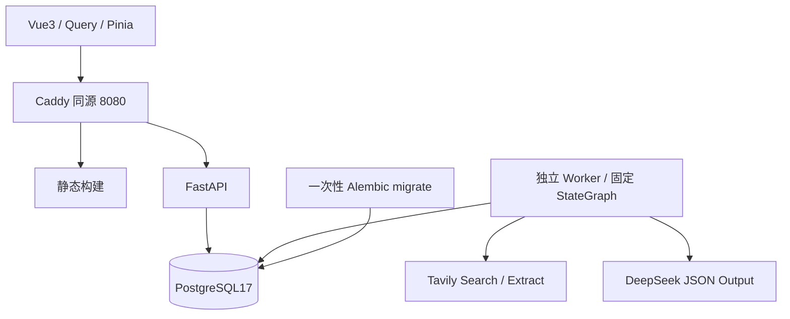

# 实际架构

2026-10-23，schema head `0010`，Prompt `2026-10-23.6`。实现按既定 Vue3 / FastAPI / PostgreSQL17 / LangGraph 架构，未引入 Redis、托管图平台或向量库。

## 模块与依赖方向

`api` 负责认证依赖、统一错误和请求上下文；`modules` 内按 identity、profiles、discovery、jobs、applications、preparation、interview、tasks、offers、operations、control、runs 划分领域。各域 DTO 与 ORM 分离。跨领域用服务或明确只读查询。`workflows` 负责领域编排，`providers` 负责固定外部 API，`worker/context.py` 负责预算、步骤、租约保护与调用记录，`infrastructure` 管配置、DB、owner、模型登记与数据库约束。

前端 `features` 对应各域，`api/schema.d.ts` 从 OpenAPI 生成；统一 openapi-fetch 客户端处理 Cookie/CSRF/错误。TanStack Vue Query 是服务端数据缓存，Pinia 只保留会话视图。退出清空私有缓存；不使用 localStorage 保存正文或 token。界面只渲染转义文本。

## 任务、事务与恢复

写 API 在事务内创建 agent_runs 后返回 202。Worker claim 采用 PostgreSQL advisory transaction lock 串行化容量决策、FOR UPDATE SKIP LOCKED 领取，默认全局 2 / 每用户 1；每个 Worker 进程顺序执行一个任务，可起多个 Worker。租约 120 秒、心跳 15 秒，最多 3 次领取。每次领取产生新的 fencing token；旧执行者不能提交步骤或最终业务结果。

固定 StateGraph 入口校验后进入具体领域节点，内部搜索、Extract、归一、生成等步骤都有持久 step_key。图状态只含 ID 与受控结果引用。无 checkpointer / interrupt / MemorySaver；重启从入口再进，按步骤键和输入哈希复用已完成产物。哈希包含输入、版本、Schema、模型、Prompt 与输出上限。用户审核是图结束后的业务 API。

外部网络调用在 DB 事务外执行；先短事务预留 ProviderCall 预算，网络结束再以新事务校验租约、输入可用性、授权和基准。崩溃中的远端调用可能已经计费，恢复标为 usage 未知，不能保证远端恰好调用一次。完成步骤可复用，发布与副作用使用事务、幂等表及唯一业务键防重。

HTTP 超时 60 秒，受控重试最多 2 次；语义/schema 修正最多一次。每 run 默认 50 次调用、80000 输入估算、24000 输出和 600 秒总时限。输入使用 UTF-8 字节保守估算；真实 usage 与未知状态分别记录。终态 succeeded / partial / failed / cancelled 清楚区分。取消在每次调用前后检查，已获得结果保留，后续副作用停止。

run_events 使用 owner/run/seq 唯一递增序号；SSE 支持 Last-Event-ID 或 after 补发、心跳和轮询回退，每次交付复查会话。run_steps、run_events、provider_calls、audit_events 职责分开，日志不记录私有正文或密钥。

## 版本与确认边界

原始简历、文本快照、JD、资料、生成材料/题单均形成不可变版本。字段引文必须是 pN 段落中原文片段；模型不能把字段标为本人补充或自行确认。人工改值记 user_asserted。来源摘要不能当正文，目录/非岗位文本不能生成完整岗位。

资格规则固定输出 pass/fail/unknown，不由模型打最终分。技能按边界词典，日薪/月薪保留原单位，持续时间按日历月。核验来源、风险、可投状态独立；网络失败不等于关闭。

事实有稳定 UUID 与状态；仅 user_confirmed 且未全局撤回的事实用于过去经历自述。正文变更必须新 fact ID；降为未确认/计划/争议也全局撤回旧 ID 的新引用。撤回不是修改旧历史文本，但会阻止新的生成与批准。

application_submissions 锁定实际投递时的资料、JD 和材料；当前最新版不会改旧提交。preparation basis_revision 显式选定基准；切换、删除、撤回或修改内容后旧批准失效。批准/采用检查 version、payload_hash、basis_revision，重复请求只有一组副作用。轮次改期更新既有任务；关闭申请按用户 keep/cancel/detach 选择处理任务。

Offer 为本人记录的独立事实，口头/书面与决定分开；回复期限经过不自动认定失效；接受一份只更新关联申请。

## 权限、来源与数据控制

owner 来自会话/Worker 上下文，DTO 不接受 owner_id；普通对象查询均限定本人，他人对象统一 404。高风险父子关系补充 owner 复合外键。用户名密码 Argon2id，会话只保存高熵 opaque token 的哈希，7 天绝对期限；CSRF 双提交值与精确 Origin 校验，包括登录。管理员只维护来源、汇总和用户主动分享的举报文本，无任意简历读取入口。

Provider 地址固定；普通用户不能传 key 或 base URL。URL 只允许 http/https、标准端口、无凭据，拒绝私网字面量及 DNS 私网解析。正文只经 Tavily Extract，且必须符合来源域名/用途/状态/存储策略。未知站点 metadata_only，正文快照标为提供商提取文本。来源策略收紧会清理对应快照、引用和衍生产物，定期维护防止晚到结果恢复正文。

删除先锁 owner、立即标不可用、取消相关活动任务，再由 Worker 按显式依赖清理正文/事实/生成/题目/回答/反馈/步骤/任务历史/导出。混合来源生成版本保守整版清理。最终提交再次校验，防止删除后复活。账户删除立即禁用及撤销会话；仅留下受限哈希回执查询删除状态。导出本人异步 JSON 或 CSV 摘要，24 小时过期清理，CSV 防公式。

## 迁移与部署

0001 基础元数据；0002 身份/资料/JD/运行；0003 搜索；0004 申请/材料/任务；0005 练习；0006 Offer/运营/数据控制；0007 owner 关联约束；0008 状态约束与任务历史；0009 同岗位外部 ID 的 URL 别名；0010 带 owner 外键的招聘卡片版本表。API readiness 检查 PG 与 head。只由 migrate 服务迁移，运行进程不 create_all。

## 统一招聘卡片

自然语言条件在已确认的搜索运行内解析，显式城市/天数与调用上限由后端保留。找岗使用 Tavily advanced 的较长公开摘要；未知域仍不执行 Extract。正文可读时沿用原有 JD 归一链路，公开摘要与允许保存的正文再分批交给模型整理成统一字段，每批3条、有预算、步骤缓存、一次修正、租约与取消保护。

`search_candidate_analyses` 独立保存每次分析版本，候选接口只返回最新有效版本。公司、名称、薪资、要求等事实字段须是该候选原文连续片段，否则清除；粗略难度与准备建议单独标注为 AI 预测，不写入确定性资格结论。无明确职位的目录只显示在折叠线索中。摘要卡片不会冒充完整 JD，也不会自动创建已核实 JobVersion。来源策略收紧会清理衍生卡片；导出与账号删除覆盖新表。

`public_info_ai_consent=true` 仅授权 search/search_parse/search_organize 处理本次公开搜索条件及公开资料；入队和 Worker 双重限制不能附带 profile/resume/application 引用。不会修改全局个人资料模型授权。个人资料任务仍走原授权检查。旧搜索可新建 search_organize 运行重整已保存材料，不再付费执行 Search/Extract。前端按公司/岗位/地点合并同岗来源并支持难度筛选与保存申请意向。

镜像固定标签与 digest，见 `infra/images.md`。Compose 持久卷，DB 不暴露宿主端口；Vite 是开发代理，Caddy 是部署入口。开发本机、测试与实际验收数据库分离。无公网发布、备份或真实投递配置。

Live修复：抽取输入显式附带与后端相同的pN段落映射，任务规则解释学历/日历月/事实/来源约束。一次语义修正携带有限的字段路径与错误码，不携带额外私有正文。输入映射与系统规则纳入步骤哈希及预算，Prompt版本升级到2026-10-23.3；不放宽证据校验。
